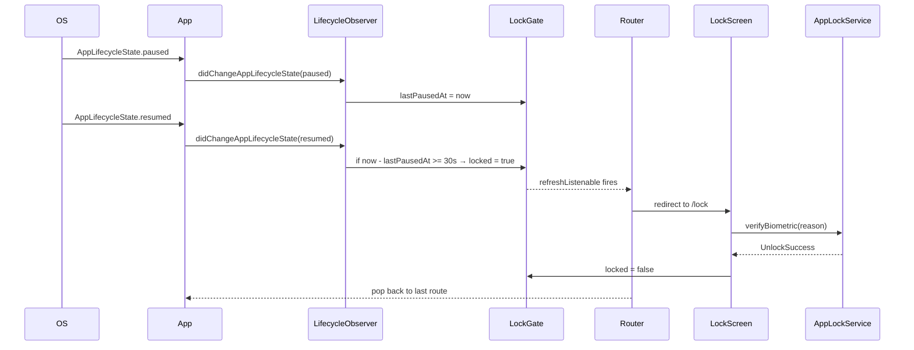
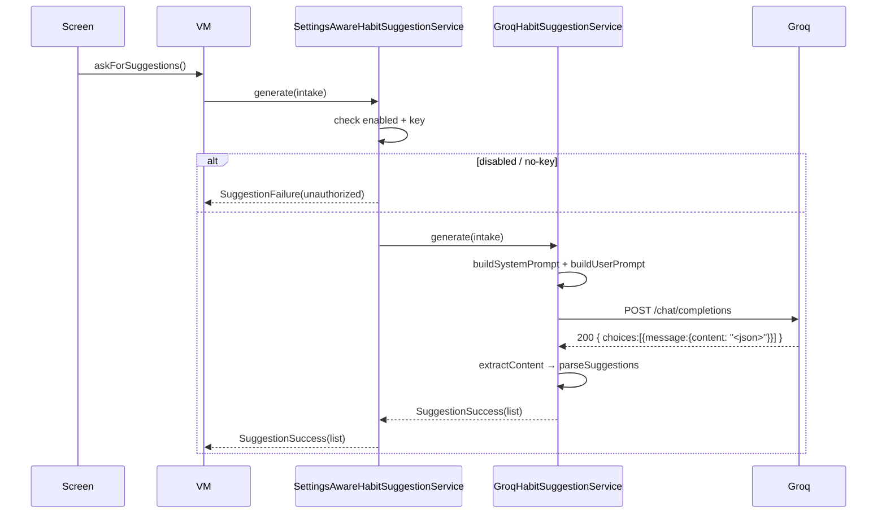

# Habit It — Technical Stories

**Document version:** 1.0 · **Date:** 2026-06-02 · **Status:** Engineering blueprint, ready to pick up

This document is the engineering counterpart of [`BUSINESS_STORIES.md`](BUSINESS_STORIES.md). For every business story (FND-001 … UX-003) there is a `TS-<ID>` block below specifying the files to touch, the Dart interfaces, the sequence of calls from UI to repository to source, the state transitions, the data shape changes, the edge cases, and the tests to write. Cross-cutting designs that touch many stories (architecture diagram, layout, contracts, routing table, Hive schema, theme tokens, error model, threading, testing) live in §1 – §11 before the per-story breakdown so they are referenced and not duplicated.

Conventions used throughout:

- File paths are repo-relative from `habit-it-app/`.
- Reference-app citations are written as `<repo>/<path>:<lines>`. Example: `padlock_app/lib/features/settings/viewmodels/settings_viewmodel.dart:8-61` — that is the entire `SettingsViewModel` class.
- All Dart code blocks are real signatures to type in, not pseudo.
- Each story header links back to `BUSINESS_STORIES.md#<id>` so you can read the acceptance criteria; this document does **not** restate them.

---

## 1. Architecture overview

The target app is a four-layer clean-architecture Flutter app: **presentation** (Screens + ViewModels) depends on **domain** (abstract repository contracts + Freezed entities + sealed `Failure`), and **data** (Hive sources, secure storage, Groq HTTP) implements those contracts. Cross-cutting **core** (DI, router, theme, services) sits beside all three. The dependency arrow always points **inward** toward domain — domain has zero `flutter`, `hive`, `http`, or `pointycastle` imports.

```
                                  ┌───────────────────────────────────────────┐
                                  │              presentation                 │
                                  │                                           │
                                  │  Screens (StatelessWidget / Stateful with │
                                  │  StreamBuilder)                           │
                                  │                                           │
                                  │  ViewModels (RxDart BehaviorSubject<T>)   │
                                  └─────────────┬─────────────────────────────┘
                                                │ depends on (interfaces)
                                                ▼
                                  ┌───────────────────────────────────────────┐
                                  │                  domain                   │
                                  │                                           │
                                  │  abstract  IHabitRepository, ISettings... │
                                  │  Freezed   Habit, SettingsModel, ...      │
                                  │  sealed    Failure, Result<T>             │
                                  └─────────────▲─────────────────────────────┘
                                                │ implemented by
                                                │
   ┌────────────────────────────────────────────┴───────────────────────────┐
   │                                                                        │
   ▼                                                                        ▼
┌──────────────────────────────────┐                  ┌────────────────────────────────────┐
│              data                │                  │                core                │
│                                  │                  │                                    │
│  HiveHabitSource (Hive boxes)    │                  │  injection.dart  (GetIt)           │
│  HiveSettingsSource              │                  │  app_router.dart (GoRouter)        │
│  HiveNotesSource                 │                  │  theme/* (colors, spacing, types)  │
│  SecurePasscodeSource (FSS)      │                  │  services/notifications/*          │
│  SecureGroqKeySource (FSS)       │◀── consumed by ──│  services/auth/* (PIN, lock)       │
│  GroqHabitSuggestionDataSource   │                  │  services/ai/* (settings-aware)    │
│  RepositoryImpls                 │                  │  managers/* (storage, biometric)   │
└──────────────────────────────────┘                  └────────────────────────────────────┘
```

Rules the lints (or PR review) enforce:

1. `lib/features/**` may import `lib/core/**`, `lib/data/<repository contracts>`, and `lib/widgets/**`. It MUST NOT import `lib/data/datasources/**`, `lib/data/sources/**`, or anything in `package:hive`, `package:http`, `package:pointycastle`.
2. `lib/data/repositories/*_impl.dart` is the only place that imports `lib/data/datasources/**`.
3. Domain types (entities, repository interfaces, `Failure`, `Result`) live under `lib/data/` to match the workspace habit-it convention (padlock keeps domain types under `data/` too — entities + repositories + models share a folder). Repositories never `throw`; they return `Result<T>` (see §8).
4. `flutter_localizations`, `intl`, `package:flutter/material.dart` are forbidden in domain and data-source files.

---

## 2. Module / package layout

This is the full `lib/` tree after Release 1 ships. `*.freezed.dart` and `*.g.dart` are generated by `build_runner` and committed.

```
lib/
├── main.dart                                 # Hive.initFlutter, init DI, runApp
├── app.dart                                  # HabitItApp: MaterialApp.router + theme/locale notifiers
│
├── core/
│   ├── config/
│   │   └── app_config.dart                   # const flags (kDebugAi, kRateLimitWindow, etc.)
│   ├── constants/
│   │   ├── app_constants.dart                # public misc constants
│   │   ├── security_constants.dart           # kPinLength=4, kFirstLockoutAttempt=5 …
│   │   ├── hive_box_keys.dart                # box & key names (single source of truth — see §5)
│   │   └── secure_storage_keys.dart          # FSS keys (see §6)
│   ├── di/
│   │   └── injection.dart                    # GetIt registrations (replaces injection_container.dart)
│   ├── extensions/
│   │   ├── build_context_x.dart              # context.height, context.width, etc.
│   │   ├── date_time_x.dart                  # isSameDate, isInSameMonth, monthKey, weekdayName
│   │   ├── string_x.dart                     # 'key'.tr extension (replaces AppLocalizationHelper.translate)
│   │   └── theme_x.dart                      # AppColors.of(context) helper
│   ├── localization/
│   │   ├── app_localization.dart             # JSON loader, locale delegate
│   │   ├── app_localization_keys.dart        # const Dart keys mirroring en.json (kept from current code)
│   │   └── app_localization_setup.dart       # delegates list for MaterialApp
│   ├── managers/
│   │   ├── biometric/
│   │   │   ├── i_biometric_manager.dart      # contract
│   │   │   └── biometric_manager_impl.dart   # local_auth wrapper (upgraded from 2.1.7 → 2.3.0)
│   │   └── secure_storage/
│   │       ├── i_secure_storage.dart         # contract
│   │       └── secure_storage_impl.dart      # flutter_secure_storage 9.2.2 wrapper
│   ├── router/
│   │   ├── app_router.dart                   # GoRouter + StatefulShellRoute (see §4)
│   │   ├── app_routes.dart                   # const String path/name pairs
│   │   └── app_route_guards.dart             # redirect logic (auth gating, lock)
│   ├── services/
│   │   ├── auth/
│   │   │   ├── i_passcode_service.dart       # contract (PBKDF2 hash + lockout state)
│   │   │   ├── passcode_service_impl.dart    # port of vault-it/.../passcode_service.dart
│   │   │   ├── app_lock_service.dart         # consolidates lock policy + UnlockResult (vault-it port)
│   │   │   └── auth_migrator.dart            # legacy plain-text PIN → PBKDF2 (AUTH-001)
│   │   ├── notifications/
│   │   │   ├── i_notification_service.dart   # contract
│   │   │   ├── notification_service_impl.dart# flutter_local_notifications + timezone
│   │   │   ├── notification_id_resolver.dart # stable habit-id → int32 mapping (uuid.v5)
│   │   │   └── notification_payload.dart     # Freezed payload {habitId, scheduledForIso, action}
│   │   ├── ai/
│   │   │   ├── i_habit_suggestion_service.dart       # contract
│   │   │   ├── groq_habit_suggestion_service.dart    # OpenAI-compatible POST (readline port)
│   │   │   ├── settings_aware_habit_suggestion_service.dart
│   │   │   ├── habit_suggestion_prompt_builder.dart  # system + user prompt
│   │   │   ├── habit_suggestion_response_parser.dart # defensive JSON parser
│   │   │   ├── groq_credential_validator.dart        # GET /models probe
│   │   │   └── groq_config.dart                      # baseUrl, model id, timeouts
│   │   ├── backup/
│   │   │   ├── i_backup_service.dart
│   │   │   ├── backup_service_impl.dart      # export/import + transactional snapshot
│   │   │   └── reset_service.dart            # whitelisted Hive/FSS/SP wipe
│   │   ├── migration/
│   │   │   └── shared_prefs_to_hive_migrator.dart    # one-shot SP → Hive on first boot (FND-002)
│   │   └── streak/
│   │       └── streak_calculator.dart        # pure function: List<Habit> → (current,longest)
│   ├── theme/
│   │   ├── app_colors.dart                   # AppColors.light/.dark fields (see §10)
│   │   ├── app_spacing.dart                  # xxs=4, xs=8, sm=12, md=16, lg=20, xl=24, xxl=32, xxxl=40
│   │   ├── app_typography.dart               # displayLarge, titleLarge, …, labelSmall
│   │   ├── app_radius.dart                   # smBorder=8, mdBorder=12, lgBorder=16, pillBorder=999
│   │   ├── app_theme.dart                    # ThemeFactory.light()/.dark()
│   │   └── theme_notifier.dart               # ValueNotifier<ThemeMode> + ValueNotifier<Locale>
│   └── utils/
│       ├── result.dart                       # sealed Result<T> { Ok(T) | Err(Failure) }
│       ├── failure.dart                      # sealed Failure (see §8)
│       └── rate_limiter.dart                 # token-bucket helper for Magic Coach
│
├── data/
│   ├── entities/
│   │   ├── app_entity.dart, *.freezed.dart, *.g.dart
│   │   ├── user_entity.dart, *.freezed.dart, *.g.dart
│   │   ├── habit_entity.dart, *.freezed.dart, *.g.dart
│   │   ├── habit_progress_entity.dart, *.freezed.dart, *.g.dart
│   │   ├── habit_stats_entity.dart, *.freezed.dart, *.g.dart
│   │   ├── habit_schedule.dart, *.freezed.dart, *.g.dart          # sealed union (SCH-001)
│   │   ├── habit_reminder.dart, *.freezed.dart, *.g.dart
│   │   ├── habit_note.dart, *.freezed.dart, *.g.dart
│   │   ├── habit_category.dart, *.freezed.dart, *.g.dart
│   │   ├── habit_target.dart, *.freezed.dart, *.g.dart            # UX-001
│   │   ├── habit_suggestion.dart, *.freezed.dart, *.g.dart        # AI in-memory only
│   │   ├── magic_intake.dart, *.freezed.dart, *.g.dart
│   │   └── settings_model.dart, *.freezed.dart, *.g.dart
│   ├── enums/
│   │   ├── habit_state.dart      # CREATED, DONE, NOT_DONE, SUSPENDED, IN_PROGRESS (appended)
│   │   ├── day.dart              # Monday..Sunday (unchanged ordinal)
│   │   ├── gender.dart           # male, female (unchanged ordinal)
│   │   └── *.g.dart              # JsonEnum wireName mappings (FND-003)
│   ├── repositories/             # abstract interfaces only
│   │   ├── i_app_repository.dart
│   │   ├── i_user_repository.dart
│   │   ├── i_habit_repository.dart
│   │   ├── i_habit_stats_repository.dart
│   │   ├── i_settings_repository.dart
│   │   ├── i_notification_repository.dart
│   │   ├── i_magic_repository.dart
│   │   └── i_notes_repository.dart
│   └── datasources/              # implementations
│       ├── hive/
│       │   ├── hive_app_source.dart
│       │   ├── hive_user_source.dart
│       │   ├── hive_habit_source.dart
│       │   ├── hive_settings_source.dart
│       │   ├── hive_notification_meta_source.dart
│       │   ├── hive_magic_meta_source.dart
│       │   └── hive_notes_source.dart
│       ├── repositories_impl/    # impls live with data, not domain
│       │   ├── app_repository_impl.dart
│       │   ├── user_repository_impl.dart
│       │   ├── habit_repository_impl.dart
│       │   ├── habit_stats_repository_impl.dart
│       │   ├── settings_repository_impl.dart
│       │   ├── notification_repository_impl.dart
│       │   ├── magic_repository_impl.dart
│       │   └── notes_repository_impl.dart
│       └── remote/
│           └── groq_chat_completions_client.dart  # thin http wrapper used by ai/
│
├── features/
│   ├── splash/
│   │   ├── screens/splash_screen.dart
│   │   ├── viewmodels/splash_viewmodel.dart
│   │   └── widgets/
│   ├── onboarding/
│   │   ├── screens/onboarding_screen.dart
│   │   ├── viewmodels/onboarding_viewmodel.dart
│   │   └── widgets/
│   ├── auth/
│   │   ├── screens/
│   │   │   ├── signup_welcome_screen.dart
│   │   │   ├── passcode_setup_screen.dart
│   │   │   ├── biometric_opt_in_screen.dart
│   │   │   ├── signup_profile_screen.dart
│   │   │   ├── lock_screen.dart                    # AUTH-005
│   │   │   ├── change_pin_screen.dart              # AUTH-007
│   │   │   └── pin_migrate_prompt_screen.dart      # AUTH-001 legacy migration
│   │   ├── viewmodels/
│   │   │   ├── passcode_setup_viewmodel.dart
│   │   │   ├── biometric_opt_in_viewmodel.dart
│   │   │   ├── signup_profile_viewmodel.dart
│   │   │   ├── lock_viewmodel.dart
│   │   │   └── change_pin_viewmodel.dart
│   │   └── widgets/
│   │       ├── passcode_keypad.dart                # AUTH-002 (port of vault-it widget)
│   │       └── passcode_dots_indicator.dart
│   ├── shell/                                       # StatefulShellRoute host
│   │   ├── screens/app_shell.dart
│   │   └── widgets/bottom_nav_bar.dart
│   ├── habits/
│   │   ├── screens/
│   │   │   ├── habits_screen.dart                  # Today / list landing
│   │   │   ├── add_habit_screen.dart
│   │   │   ├── manage_habits_screen.dart
│   │   │   └── habit_detail_screen.dart            # ENG-003
│   │   ├── viewmodels/
│   │   │   ├── habits_viewmodel.dart
│   │   │   ├── add_habit_viewmodel.dart
│   │   │   ├── manage_habits_viewmodel.dart
│   │   │   └── habit_detail_viewmodel.dart
│   │   └── widgets/
│   │       ├── habit_item_widget.dart
│   │       ├── habit_list_widget.dart
│   │       ├── streak_chip.dart                    # ENG-002
│   │       ├── week_dot_strip.dart                 # ENG-007 today-week dots
│   │       └── weekly_calendar_bar.dart            # SCH-004 (replaces CalendarAppBar)
│   ├── stats/
│   │   ├── screens/
│   │   │   ├── stats_hub_screen.dart
│   │   │   ├── month_stats_screen.dart
│   │   │   └── month_progress_screen.dart
│   │   └── viewmodels/
│   │       ├── stats_hub_viewmodel.dart
│   │       ├── month_stats_viewmodel.dart
│   │       └── month_progress_viewmodel.dart
│   ├── settings/
│   │   ├── screens/
│   │   │   ├── settings_screen.dart                # SET-001 hub
│   │   │   ├── edit_profile_screen.dart            # SET-003
│   │   │   ├── security_screen.dart                # SET-004
│   │   │   ├── appearance_screen.dart              # SET-005
│   │   │   ├── language_screen.dart                # SET-006
│   │   │   ├── notifications_screen.dart           # SET-007
│   │   │   ├── ai_coach_settings_screen.dart       # SET-008
│   │   │   ├── data_screen.dart                    # SET-009
│   │   │   ├── habit_defaults_screen.dart          # SET-010
│   │   │   ├── about_screen.dart                   # SET-011
│   │   │   ├── help_screen.dart                    # SET-012
│   │   │   ├── bug_report_screen.dart              # SET-013
│   │   │   ├── rate_app_screen.dart                # SET-014
│   │   │   ├── privacy_policy_screen.dart          # SET-015
│   │   │   └── terms_of_service_screen.dart        # SET-015
│   │   ├── viewmodels/
│   │   │   ├── settings_viewmodel.dart             # SET-002 — shared by hub + subs
│   │   │   ├── edit_profile_viewmodel.dart
│   │   │   ├── ai_coach_settings_viewmodel.dart
│   │   │   └── notifications_settings_viewmodel.dart
│   │   └── widgets/
│   │       ├── settings_section_card.dart          # ported from padlock
│   │       ├── settings_row_chevron.dart           # padlock_app/lib/features/settings/widgets/settings_row_chevron.dart:1-88
│   │       ├── settings_row_toggle.dart
│   │       ├── settings_picker_option.dart
│   │       └── settings_header.dart                # avatar + username + "Edit profile" tile
│   ├── coach/                                       # AI epic
│   │   ├── screens/
│   │   │   ├── coach_intake_screen.dart            # AI-005
│   │   │   ├── coach_suggestions_screen.dart      # AI-006
│   │   │   └── coach_privacy_modal.dart            # AI-007 (one-time bottom sheet)
│   │   ├── viewmodels/
│   │   │   ├── coach_intake_viewmodel.dart
│   │   │   └── coach_suggestions_viewmodel.dart
│   │   └── widgets/
│   │       ├── intake_question_field.dart
│   │       └── suggestion_card.dart
│   └── support/
│       └── (covered by settings/ — SET-012..015)
│
└── widgets/                                          # cross-feature shared UI
    ├── app_bar/
    │   ├── header_widget.dart                       # ported, theme-token-aware
    │   └── cupertino_app_bar_widget.dart
    ├── buttons/
    │   ├── button_widget.dart
    │   └── icon_text_button_widget.dart
    ├── forms/
    │   ├── text_field_widget.dart
    │   ├── custom_dropdown.dart
    │   └── day_picker/
    ├── feedback/
    │   ├── app_notifier.dart                        # thinned: snackbar + toast only
    │   └── confirmation_dialog.dart
    ├── floating/
    │   ├── floating_speed_dial.dart
    │   └── floating_speed_dial_child.dart
    ├── tap_scale.dart                                # ported from padlock
    └── title_divider_widget.dart
```

What gets deleted vs. moved:

- `lib/injection_container.dart` → moved & renamed to `lib/core/di/injection.dart` (FND-001).
- `lib/config/themes/app_theme.dart` → replaced by `lib/core/theme/app_theme.dart` (FND-004).
- `lib/config/routes/app_routes.dart` → replaced by `lib/core/router/app_router.dart` + `app_routes.dart` (FND-005).
- `lib/config/locale/*` → moved to `lib/core/localization/`.
- `lib/core/widgets/` (current location) → split between `lib/widgets/` (cross-feature) and feature-specific `lib/features/*/widgets/`.
- `lib/core/utils/{app_colors,app_text_styles,hex_color}.dart` → replaced by `lib/core/theme/*.dart` tokens (FND-004).
- `lib/core/validation/` → kept but `signupEmail`, `signupPhone`, `signupBirthDate` rules removed (AUTH-008 AC#3).
- `lib/features/app-navigator/`, `lib/features/signup/`, `lib/features/signin/`, `lib/features/profile/` → replaced by `lib/features/{shell,auth,settings}/` directories above.

---

## 3. Repository / ViewModel contract templates

### 3.1 Repository contract template

Every repository is an abstract interface in `lib/data/repositories/i_<noun>_repository.dart`, an Impl in `lib/data/datasources/repositories_impl/<noun>_repository_impl.dart`, and a Hive source in `lib/data/datasources/hive/hive_<noun>_source.dart`. The Impl never throws; it converts source exceptions to `Failure` and returns `Result<T>`. Mutations are serialised through a `Future` queue (mirror `padlock_app/lib/data/repositories/settings_repository.dart:25-37`).

```dart
// lib/data/repositories/i_settings_repository.dart
import 'package:habit_it/data/entities/settings_model.dart';
import 'package:habit_it/core/utils/result.dart';

abstract class ISettingsRepository {
  Stream<SettingsModel> watch();
  Future<Result<SettingsModel>> get();
  Future<Result<void>> updateThemeMode(String mode);          // 'system' | 'light' | 'dark'
  Future<Result<void>> updateAccentColor(String hex);
  Future<Result<void>> updateLocale(String? code);
  Future<Result<void>> updateNotificationsEnabled(bool v);
  Future<Result<void>> updateDailySummary({required bool enabled, required String hhmm});
  Future<Result<void>> updateDefaultSchedule(HabitSchedule schedule);
  Future<Result<void>> updateDefaultReminderHhmm(String? hhmm);
  Future<Result<void>> updateBiometricEnabled(bool v);
  Future<Result<void>> updateAiEnabled(bool v);
  Future<Result<void>> updateAiModel(String modelId);
  Future<Result<void>> updateDefaultLanding(LandingMode mode);
  Future<Result<void>> markCoachPrivacyAcknowledged();
}
```

```dart
// lib/data/datasources/repositories_impl/settings_repository_impl.dart
class SettingsRepositoryImpl implements ISettingsRepository {
  SettingsRepositoryImpl(this._source);
  final HiveSettingsSource _source;
  final BehaviorSubject<SettingsModel> _stream = BehaviorSubject<SettingsModel>();
  Future<void> _serial = Future.value();

  @override Stream<SettingsModel> watch() => _stream;

  @override Future<Result<SettingsModel>> get() async {
    try {
      final m = await _source.read();
      if (!_stream.isClosed && _stream.valueOrNull != m) _stream.add(m);
      return Ok(m);
    } catch (e, st) { return Err(Failure.storage(e.toString(), st)); }
  }

  Future<Result<void>> _mutate(SettingsModel Function(SettingsModel) f) {
    final completer = Completer<Result<void>>();
    _serial = _serial.then((_) async {
      try {
        final current = await _source.read();
        final next = f(current);
        await _source.write(next);
        if (!_stream.isClosed) _stream.add(next);
        completer.complete(const Ok(null));
      } catch (e, st) {
        completer.complete(Err(Failure.storage(e.toString(), st)));
      }
    });
    return completer.future;
  }
  // ... per-field updaters delegate to _mutate(...)
}
```

```dart
// lib/data/datasources/hive/hive_settings_source.dart
class HiveSettingsSource {
  static const _boxName = HiveBoxKeys.settings;        // 'settings'
  static const _key = HiveBoxKeys.appSettings;         // 'app_settings'

  Future<SettingsModel> read() async {
    final box = await Hive.openBox<Map>(_boxName);
    final raw = box.get(_key);
    if (raw == null) return SettingsModel.defaults();
    return SettingsModel.fromJson(Map<String, dynamic>.from(raw));
  }
  Future<void> write(SettingsModel m) async {
    final box = await Hive.openBox<Map>(_boxName);
    await box.put(_key, m.toJson());
  }
}
```

### 3.2 ViewModel contract template

ViewModels expose **only** `BehaviorSubject<T>` streams + commands. They take repositories via constructor (default to `getIt<T>()` when not provided so tests can swap). Screens never call repositories. ViewModels call `dispose()` from the screen's `dispose()`.

```dart
// lib/features/<feature>/viewmodels/<feature>_viewmodel.dart — template
class FooViewModel {
  FooViewModel({IFooRepository? repo})
      : _repo = repo ?? getIt<IFooRepository>();
  final IFooRepository _repo;

  final BehaviorSubject<FooUiState> state$ = BehaviorSubject.seeded(const FooUiState.loading());
  final PublishSubject<FooEvent> events$ = PublishSubject();      // one-shot: snackbar/navigation

  StreamSubscription? _sub;

  Future<void> load() async {
    state$.add(const FooUiState.loading());
    final r = await _repo.fetch();
    state$.add(r.when(ok: FooUiState.ready, err: FooUiState.error));
  }

  void dispose() {
    _sub?.cancel();
    state$.close();
    events$.close();
  }
}
```

Each ViewModel-backed screen also declares a Freezed `FooUiState` union (see § per-story breakdowns). Pattern matched with `state.when(...)` to render. **Never store loaded data inside the screen `State`**: bind via `StreamBuilder<FooUiState>(stream: vm.state$, ...)`.

Reference for this pattern: `padlock_app/lib/features/settings/viewmodels/settings_viewmodel.dart:8-61`.

---

## 4. Routing table (GoRouter)

`lib/core/router/app_router.dart` exports `final appRouter = GoRouter(...)`. Naming convention: `path` for navigation, `name` for `context.goNamed('habits')`. All settings sub-screens are **flat top-level routes** so users can deep-link to them (mirrors padlock pattern at `padlock_app/lib/core/router/app_router.dart:18-134`).

| Path | Name | Builder | Guards / extras |
|---|---|---|---|
| `/` | `splash` | `SplashScreen` | — |
| `/onboarding` | `onboarding` | `OnboardingScreen` | — |
| `/signup/welcome` | `signupWelcome` | `SignupWelcomeScreen` | redirect if registered → `/app/habits` |
| `/signup/passcode` | `signupPasscode` | `PasscodeSetupScreen` | redirect if registered → `/app/habits` |
| `/signup/biometric` | `signupBiometric` | `BiometricOptInScreen` | redirect if registered → `/app/habits` |
| `/signup/profile` | `signupProfile` | `SignupProfileScreen` | redirect if registered → `/app/habits` |
| `/signup/pin-migrate` | `signupPinMigrate` | `PinMigratePromptScreen` | only when `user.password != null && passcode.isSet() == false` |
| `/lock` | `lock` | `LockScreen` | sticky route via `app_route_guards.dart` |
| `/app` (StatefulShellRoute.indexedStack) | `app` | `AppShell` | redirect to `/lock` if `!authenticated` |
|   ↳ branch 0: `/app/habits` | `habits` | `HabitsScreen` | — |
|   ↳ branch 1: `/app/stats` | `stats` | `StatsHubScreen` | — |
|   ↳ branch 2: `/app/settings` | `settings` | `SettingsScreen` | — |
| `/app/habits/add` | `addHabit` | `AddHabitScreen` | outside shell (fullscreen) |
| `/app/habits/manage` | `manageHabits` | `ManageHabitsScreen` | query `?day=<int>` |
| `/app/habits/:habitId` | `habitDetail` | `HabitDetailScreen` | path param |
| `/app/stats/month-stats` | `monthStats` | `MonthStatsScreen` | `extra: DateTime` |
| `/app/stats/month-progress` | `monthProgress` | `MonthProgressScreen` | `extra: DateTime` |
| `/settings/profile` | `settingsProfile` | `EditProfileScreen` | — |
| `/settings/security` | `settingsSecurity` | `SecurityScreen` | — |
| `/settings/security/change-pin` | `changePin` | `ChangePinScreen` | — |
| `/settings/appearance` | `settingsAppearance` | `AppearanceScreen` | — |
| `/settings/language` | `settingsLanguage` | `LanguageScreen` | — |
| `/settings/notifications` | `settingsNotifications` | `NotificationsScreen` | — |
| `/settings/ai` | `settingsAi` | `AiCoachSettingsScreen` | — |
| `/settings/data` | `settingsData` | `DataScreen` | — |
| `/settings/habit-defaults` | `settingsHabitDefaults` | `HabitDefaultsScreen` | — |
| `/settings/about` | `settingsAbout` | `AboutScreen` | — |
| `/settings/help` | `settingsHelp` | `HelpScreen` | — |
| `/settings/bug-report` | `settingsBugReport` | `BugReportScreen` | — |
| `/settings/rate` | `settingsRate` | `RateAppScreen` | — |
| `/settings/privacy` | `settingsPrivacy` | `PrivacyPolicyScreen` | — |
| `/settings/terms` | `settingsTerms` | `TermsOfServiceScreen` | — |
| `/coach/intake` | `coachIntake` | `CoachIntakeScreen` | redirect to `/settings/ai` if not enabled or no key |
| `/coach/suggestions` | `coachSuggestions` | `CoachSuggestionsScreen` | `extra: MagicIntake` |
| `*` | — | `RouteNotFoundScreen` | `errorBuilder` |

**Redirect logic** (`app_route_guards.dart`) runs in `GoRouter.redirect`:

1. If `user.isRegistered == false` and target is not in `{onboarding, signup/*, splash}` → redirect to `/signup/welcome`.
2. If `user.isRegistered == true`, `passcode.isSet() == true`, and `lock_state.locked == true`, and target is not `/lock` → redirect to `/lock`.
3. If target is `/coach/*` and (`!settings.aiEnabled` or `!magicKeyPresent`) → redirect to `/settings/ai`.

`lock_state.locked` is held in a small `ValueNotifier<bool>` exported from `app_lock_service.dart` (so the router can listen via `refreshListenable`).

---

## 5. Hive schema

All Hive boxes are `Box<Map>` (no adapters needed — Freezed `toJson()` outputs `Map<String, dynamic>`). Box names + key names are constants in `lib/core/constants/hive_box_keys.dart`. Initialisation in `main.dart`:

```dart
await Hive.initFlutter();
await Future.wait([
  Hive.openBox<Map>(HiveBoxKeys.app),
  Hive.openBox<Map>(HiveBoxKeys.user),
  Hive.openBox<Map>(HiveBoxKeys.settings),
  Hive.openBox<Map>(HiveBoxKeys.notificationsMeta),
  Hive.openBox<Map>(HiveBoxKeys.magicMeta),
  Hive.openBox<Map>(HiveBoxKeys.notes),
  Hive.openBox<Map>(HiveBoxKeys.habits),
]);
```

| Box | Key(s) | Value | Owner | Notes |
|---|---|---|---|---|
| `app` | `app_state` | `Map<String,dynamic>` from `AppEntity.toJson()` | `HiveAppSource` | `{init: bool, initDate: 'YYYY-MM-DD', lastDate: 'YYYY-MM-DD', migratedV1: bool}` |
| `user` | `user_state` | `UserEntity.toJson()` | `HiveUserSource` | `{id, username, gender, isRegistered, isAuthenticated, isPINAuthenticated, isBiometricAuthenticated, password (deprecated)}` |
| `settings` | `app_settings` | `SettingsModel.toJson()` | `HiveSettingsSource` | One value, full settings blob |
| `habits` | one key per month: `month/<YYYY>-<M>` | `List<HabitEntity.toJson()>` | `HiveHabitSource` | Plus `month_init/<YYYY>-<M>: bool` and `day_init/<YYYY>-<M>-<D>: bool` |
| `notes` | `<habitId>/<YYYY>-<M>-<D>` | `HabitNote.toJson()` | `HiveNotesSource` | One value per (habit, date) |
| `notifications_meta` | `<habitId>` | `{ notificationId: int32, lastScheduledFor: ISO8601 }` | `HiveNotificationMetaSource` | Used to overwrite/cancel on reschedule |
| `magic_meta` | `quota_log` | `{ requests: [iso8601, ...] }` | `HiveMagicMetaSource` | Rate-limit log (AI-005 AC#6); pruned to last 24h |
| `magic_meta` | `coach_privacy_ack` | `bool` | same | One-time AI-007 modal flag |

**Why per-month keys for habits?** Mirrors the legacy SharedPreferences scheme so migration is straightforward: legacy `APP/HABIT/MONTH/<YYYY>-<M>` becomes `habits` box, key `month/<YYYY>-<M>`. The day-init flags (`APP/HABIT/INIT/<YYYY>-<M>-<D>`) become keys `day_init/<YYYY>-<M>-<D>` in the same box.

---

## 6. Secure-storage schema (`flutter_secure_storage`)

All keys are constants in `lib/core/constants/secure_storage_keys.dart`.

| Key | Value | Owner |
|---|---|---|
| `auth.pin_hash` | `"1$<base64Salt>$<base64Hash>"` — format-version `1`, 16-byte salt, 32-byte PBKDF2-SHA256 hash, 100,000 iterations | `PasscodeServiceImpl` |
| `auth.failed_attempts` | decimal int as string | `PasscodeServiceImpl` |
| `auth.lockout_until` | ISO8601 timestamp string | `PasscodeServiceImpl` |
| `magic.groq_api_key` | raw API key string (`gsk_...`) | `SecureGroqKeySource` |

Reference port: `vault-it-app/lib/core/services/passcode_service.dart:24-119` for the exact format, derivator, and constant-time compare.

---

## 7. Notification schema

Channel ids (Android):
- `habit_reminders` (importance: high, vibration on) — per-habit reminders.
- `daily_summary` (importance: default) — single agenda push at user-picked time.

Notification id derivation: `notificationId = uuid.v5(Namespace.url, habitId).hashCode & 0x7FFFFFFF` so it always fits in int32 and is stable per habit. Stored in `HiveNotificationMetaSource` so cancellation only needs the habit id.

Payload format (JSON-encoded into `payload: String`):

```json
{ "habitId": "<uuid>", "scheduledFor": "2026-06-02T08:00:00+02:00", "kind": "reminder" }
```

`kind` ∈ `{ "reminder", "daily_summary" }`. The tap handler deep-links via `appRouter.go('/app/habits/<habitId>')` for `reminder` and `/app/habits` for `daily_summary`.

Action button (Android only): `id: 'mark_done'` → `notification_service_impl.dart` background isolate handler reads `payload.habitId`, calls `IHabitRepository.toggle(habit, day: payload.scheduledFor.day, month: <YYYY>-<M>, to: DONE)`.

---

## 8. Error model (`Failure` + `Result<T>`)

```dart
// lib/core/utils/failure.dart
@freezed
sealed class Failure with _$Failure {
  const factory Failure.storage(String message, [StackTrace? stack]) = StorageFailure;
  const factory Failure.network(String message)                       = NetworkFailure;
  const factory Failure.timeout()                                     = TimeoutFailure;
  const factory Failure.unauthorized()                                = UnauthorizedFailure;
  const factory Failure.rateLimited(DateTime nextAttempt)             = RateLimitedFailure;
  const factory Failure.parse(String reason)                          = ParseFailure;
  const factory Failure.validation(String field, String message)      = ValidationFailure;
  const factory Failure.notFound(String entity, String id)            = NotFoundFailure;
  const factory Failure.platform(String message)                      = PlatformFailure;   // local_auth, permission_handler
  const factory Failure.unknown(String message)                       = UnknownFailure;
}
```

```dart
// lib/core/utils/result.dart
sealed class Result<T> {
  const Result();
  R when<R>({required R Function(T value) ok, required R Function(Failure f) err});
}
class Ok<T> extends Result<T>   { const Ok(this.value); final T value; }
class Err<T> extends Result<T>  { const Err(this.failure); final Failure failure; }
```

Repositories return `Result<T>`. ViewModels translate `Failure` into UI-friendly state. Screens never see `Failure` types directly except via the ViewModel's `events$` for snackbar copy.

---

## 9. Threading & async patterns

- **Reactive streams** (BehaviorSubject) for ongoing state that screens render: settings, habits-for-day, lock state, notification permission status.
- **PublishSubject** for one-shot events (snackbars, navigation requests).
- **Future** for commands (`vm.toggleHabit(...)`, `vm.savePin(...)`). The screen `await`s only if it needs to disable UI; otherwise fire-and-forget while binding to the resulting state stream.
- **Debounce** the AI Coach intake's textbox change events at 250 ms before validating length, using `Rx.debounceTime`.
- **`async*` streams** are not used in v1 — we always emit through `BehaviorSubject.add`.
- **Background isolate handler** (`flutter_local_notifications`) is the only place we touch Hive from a non-UI isolate. It re-opens its own boxes via `Hive.openBox(...)` (the package supports this) — never reuse the UI-isolate's box reference.
- **Future queue** in repositories (`_serial = _serial.then(...)`) prevents Hive write reordering (mirrors `padlock_app/lib/data/repositories/settings_repository.dart:25-37`).

---

## 10. Theme tokens — concrete mapping

`AppColors` exposes both light and dark constants; screens pick via `Theme.of(context).brightness`. Spacing/typography/radius are token-only. Mapping from today's hard-coded values:

`AppColors`:

| Token | Dark (default — current app behavior) | Light | Old reference |
|---|---|---|---|
| `background` | `#000000` | `#FFFFFF` | `AppColors.background` |
| `surface` | `#0E0E0E` | `#F5F5F5` | new |
| `surfaceContainer` | `#1C2D32` | `#E7ECEE` | `AppColors.accent` |
| `surfaceContainerHigh` | `#243A40` | `#D8DFE2` | new |
| `onSurface` | `#FFFFFF` | `#0A0A0A` | `AppColors.fontPrimary` / `fontSecondary` |
| `onSurfaceVariant` | `#B8C2C5` | `#3F4A4D` | new |
| `primary` | `#FFFFFF` | `#0A0A0A` | `AppColors.primary` / `secondary` (inverted) |
| `primaryContainer` | `#1C2D32` (default) — configurable accent (SET-005): `#FF725E`, `#00A36C`, `#0072B1`, `#900C3F` | same | `AppColors.accent` |
| `outline` | `#FFFFFF40` | `#0A0A0A40` | `AppColors.border` |
| `error` | `#900C3F` | `#900C3F` | unchanged |
| `success` | `#00A36C` | `#00A36C` | `AppColors.green` |
| `warning` | `#F44336` | `#F44336` | `AppColors.red` |
| `brandLinkedIn` | `#0072B1` | same | unchanged |
| `brandGitHub` | `#000000` / `#FFFFFF` (theme-aware) | — | unchanged |
| `brandFacebook` | `#3B5998` | same | unchanged |
| `brandWhatsApp` | `#075E54` | same | unchanged |
| `brandOutlook` | `#127CD6` | same | unchanged |

`AppSpacing`: `xxs=4, xs=8, sm=12, md=16, lg=20, xl=24, xxl=32, xxxl=40` — replaces every `SizedBox(height: 10|15|20|30)` and every `MediaQuery.size.height * 0.0X` percent literal in screens. Mirrors `padlock_app/lib/core/theme/app_spacing.dart:5-21`.

`AppTypography`:

| Token | Spec | Replaces in `app_text_styles.dart` |
|---|---|---|
| `displayLarge` | 52, w900 | `splashText` |
| `titleLarge` | 30, w400 | `onboardingSubtitle`, `signupSubtitle` |
| `titleMedium` | 24, w300 | `headerTitle`, `headerTitle2`, `profileTitle` |
| `titleSmall` | 22, w400, letterSpacing 1.4 | `appbarTitle` |
| `bodyLarge` | 18, w400 | `signupBodyDescription`, `habitNameText` |
| `bodyMedium` | 16, w400 | `signinDescription`, body text |
| `bodySmall` | 14, w300 | `statsDescription` |
| `labelLarge` | 16, w500 | button labels |
| `labelSmall` | 13, w400 | caption, hint |

`AppRadius`: `smBorder=8, mdBorder=12, lgBorder=16, pillBorder=999`. Header-curve `60` is kept as a one-off constant in `HeaderWidget` until UX-002 ships, where it becomes `lgBorder * 4` (gated for review).

---

## 11. Testing strategy

| Level | Scope | Tooling | Files |
|---|---|---|---|
| Unit | ViewModels, repositories, prompt builder, response parser, streak calculator, schedule `shouldShowOn`, migrator | `test/`, `mocktail`, `fake_async` for time | `test/features/**/<feature>_viewmodel_test.dart`, `test/data/repositories/...`, `test/core/services/...` |
| Widget | Padlock-style settings widgets, `PasscodeKeypad`, `WeekDotStrip`, `YearHeatmap` | `flutter_test`, `golden_toolkit` | `test/widgets/*.dart` |
| Integration | First-launch onboarding → signup → habit, app-lock background-foreground, AI Coach happy path with mocked Groq client | `integration_test/`, in-memory Hive (`Hive.init('/tmp/hivetest')`), `MockClient` | `integration_test/auth_flow_test.dart`, `integration_test/coach_flow_test.dart` |

Targets: 80 % coverage for `lib/core/services/**`, `lib/data/datasources/repositories_impl/**`, and `lib/features/**/viewmodels/**`. Widgets follow golden-based snapshot tests where look matters (Settings rows, lock screen).

Fixtures: `test/fixtures/legacy_shared_prefs.json` captured from a real install — drives the SharedPreferences → Hive migrator test.

---

# Per-story technical breakdown

---

## TS-FND-001 — Bootstrap the Padlock-style layered architecture
**Implements:** [`BUSINESS_STORIES.md` FND-001](BUSINESS_STORIES.md#fnd-001--bootstrap-the-padlock-style-layered-architecture)

**Files to create / modify:**
- Create the full tree in §2 (folders + empty `*.dart` files for the contracts).
- Replace `pubspec.yaml` dependency block with the table in §0 of business spec; bump `environment.sdk: '^3.8.0'`.
- Delete `lib/injection_container.dart`; create `lib/core/di/injection.dart`.
- Update `lib/main.dart` to call `Hive.initFlutter()`, set up `tz.initializeTimeZones()`, `await configureDependencies(...)`, then `runApp`.
- Wire `analysis_options.yaml` to include `package:flutter_lints/flutter.yaml` and add custom rules: `avoid_print`, `prefer_const_constructors`, and a hand-review checklist banning raw hex / EdgeInsets literals in `features/` (no analyzer plugin in v1 — code review enforces).

**Interfaces / classes:**

```dart
// lib/core/di/injection.dart
final getIt = GetIt.instance;

Future<void> configureDependencies() async {
  // External
  getIt.registerLazySingleton<FlutterSecureStorage>(() => const FlutterSecureStorage());
  getIt.registerLazySingleton<LocalAuthentication>(() => LocalAuthentication());
  getIt.registerLazySingleton<http.Client>(() => http.Client());
  getIt.registerLazySingleton<Uuid>(() => const Uuid());

  // Managers
  getIt.registerLazySingleton<ISecureStorage>(() => SecureStorageImpl(getIt()));
  getIt.registerLazySingleton<IBiometricManager>(() => BiometricManagerImpl(getIt()));

  // Hive sources
  getIt.registerLazySingleton(() => HiveAppSource());
  getIt.registerLazySingleton(() => HiveUserSource());
  getIt.registerLazySingleton(() => HiveSettingsSource());
  getIt.registerLazySingleton(() => HiveHabitSource());
  getIt.registerLazySingleton(() => HiveNotesSource());
  getIt.registerLazySingleton(() => HiveNotificationMetaSource());
  getIt.registerLazySingleton(() => HiveMagicMetaSource());

  // Repositories
  getIt.registerLazySingleton<IAppRepository>(() => AppRepositoryImpl(getIt()));
  getIt.registerLazySingleton<IUserRepository>(() => UserRepositoryImpl(getIt()));
  getIt.registerLazySingleton<ISettingsRepository>(() => SettingsRepositoryImpl(getIt()));
  getIt.registerLazySingleton<IHabitRepository>(() => HabitRepositoryImpl(getIt(), getIt<INotificationService>()));
  getIt.registerLazySingleton<IHabitStatsRepository>(() => HabitStatsRepositoryImpl(getIt()));
  getIt.registerLazySingleton<INotesRepository>(() => NotesRepositoryImpl(getIt()));
  getIt.registerLazySingleton<INotificationRepository>(() => NotificationRepositoryImpl(getIt()));
  getIt.registerLazySingleton<IMagicRepository>(() => MagicRepositoryImpl(getIt()));

  // Services
  getIt.registerLazySingleton<IPasscodeService>(() => PasscodeServiceImpl(storage: getIt()));
  getIt.registerLazySingleton<AppLockService>(() => AppLockService(passcode: getIt(), biometric: getIt()));
  getIt.registerLazySingleton<INotificationService>(() =>
      NotificationServiceImpl(plugin: FlutterLocalNotificationsPlugin(), uuid: getIt()));
  getIt.registerLazySingleton<IHabitSuggestionService>(() =>
      SettingsAwareHabitSuggestionService(settings: getIt(), magicKey: getIt(), inner: GroqHabitSuggestionService(client: getIt())));
  getIt.registerLazySingleton<IBackupService>(() => BackupServiceImpl(getIt(), getIt(), getIt(), getIt(), getIt()));
  getIt.registerLazySingleton<ResetService>(() => ResetService(getIt(), getIt()));
  getIt.registerLazySingleton<SharedPrefsToHiveMigrator>(() => SharedPrefsToHiveMigrator(getIt(), getIt(), getIt(), getIt()));
  getIt.registerLazySingleton<AuthMigrator>(() => AuthMigrator(getIt(), getIt()));
  getIt.registerLazySingleton<StreakCalculator>(() => const StreakCalculator());
}
```

**Sequence:** `main()` → `WidgetsFlutterBinding.ensureInitialized()` → `Hive.initFlutter()` → `tz.initializeTimeZones()` → open all boxes → `await configureDependencies()` → `await getIt<SharedPrefsToHiveMigrator>().runIfNeeded()` → `runApp(HabitItApp())`. `HabitItApp` watches `themeModeNotifier` + `languageNotifier` and rebuilds `MaterialApp.router` accordingly.

**Edge cases:** Hive initialisation must precede DI because sources are constructed lazily; the first source call would otherwise race with `Hive.initFlutter`. `tz` init must precede `NotificationServiceImpl`'s scheduling, which uses `TZDateTime`.

**Tests:**
- `test/core/di/injection_test.dart` — `configureDependencies` registers all interfaces; `getIt<IHabitRepository>()` is non-null.
- Integration: full bootstrap succeeds against an empty Hive temp dir.

**Open questions:** none.

---

## TS-FND-002 — Hive-backed repositories + SharedPreferences migrator
**Implements:** [FND-002](BUSINESS_STORIES.md#fnd-002--replace-sharedpreferences-with-hive-backed-repositories)

**Files to create:** all of `lib/data/datasources/hive/*` and `lib/data/datasources/repositories_impl/*` and `lib/data/repositories/*`, plus `lib/core/services/migration/shared_prefs_to_hive_migrator.dart`.

**Interfaces / classes:**

```dart
abstract class IHabitRepository {
  Stream<List<HabitEntity>> watchByMonth(MonthKey month);
  Future<Result<List<HabitEntity>>> getByMonth(MonthKey month);
  Future<Result<List<HabitEntity>>> getByDay(DateTime day);
  Future<Result<HabitEntity>> getById(String id);
  Future<Result<HabitEntity>> add(HabitDraft draft, MonthKey month);
  Future<Result<HabitEntity>> update(HabitEntity habit, MonthKey month);
  Future<Result<void>> delete(String habitId, MonthKey month);
  Future<Result<HabitEntity>> toggle(HabitEntity habit, {required DateTime day, HabitState? to});
  Future<Result<HabitEntity>> suspend(HabitEntity habit, {required DateTime day});
  Future<Result<HabitEntity>> unsuspend(HabitEntity habit, {required DateTime day});
  Future<Result<void>> reorder(int oldIndex, int newIndex, MonthKey month);
  Future<Result<void>> moveMonth({required MonthKey from, required MonthKey to, required bool carryForward});
  Future<Result<void>> initMonthIfNeeded(MonthKey month);
  Future<Result<void>> initDayIfNeeded(DateTime day, MonthKey month);  // lazy roll-forward
}
```

```dart
class SharedPrefsToHiveMigrator {
  SharedPrefsToHiveMigrator(this._sp, this._hiveApp, this._hiveUser, this._hiveHabit);
  final SharedPreferences _sp;
  final HiveAppSource _hiveApp;
  final HiveUserSource _hiveUser;
  final HiveHabitSource _hiveHabit;

  Future<MigrationReport> runIfNeeded() async {
    final app = await _hiveApp.read();
    if (app.migratedV1) return MigrationReport.skipped();
    final report = MigrationReport.empty();
    try {
      _migrateApp(report);
      _migrateUser(report);
      _migrateHabits(report);
      await _hiveApp.write(app.copyWith(migratedV1: true));
      _clearLegacyKeys();
      return report.markComplete();
    } catch (e, st) {
      return report.markFailed(e, st);
    }
  }
}
```

**Sequence (migration):**

```
main() → migrator.runIfNeeded()
   ├─ read 'APP/APP'   (json) → AppEntity → hive.app.write
   ├─ read 'APP/USER'  (json) → UserEntity → hive.user.write
   ├─ for each SP key 'APP/HABIT/MONTH/<YYYY>-<M>' (and INIT<YYYY>-<M> flag)
   │     ├─ decode List<Habit.toJson()>
   │     ├─ for each habit: coerce repeatDays → HabitSchedule.weekly(repeatDays) (SCH-001)
   │     ├─ re-serialize daysStates: keys are still <day:int>, values keep HabitState.index for now —
   │     │   FND-003 step rewrites them to wireName as part of its build pass
   │     └─ hive.habits.put('month/<YYYY>-<M>', list)
   ├─ for each 'APP/HABIT/INIT/<YYYY>-<M>-<D>' → hive.habits.put('day_init/<YYYY>-<M>-<D>', bool)
   ├─ for each 'APP/HABIT/MONTH/INIT<YYYY>-<M>' → hive.habits.put('month_init/<YYYY>-<M>', bool)
   ├─ hive.app.write(migratedV1: true)
   └─ sp.remove(<each legacy key>)
```

**Data shape changes:** `Habit` (entity) gains `schedule: HabitSchedule` (default `HabitSchedule.weekly(repeatDays)` during migration); legacy `repeatDays` becomes a derived getter. New fields `reminder: HabitReminder?`, `categoryId: String?`, `target: HabitTarget?`, `noteIds: List<String>` (all nullable / empty by default so migration is non-breaking).

**Edge cases:**
- Legacy month-init key has no hyphen between `INIT` and `<YYYY>` (`APP/HABIT/MONTH/INIT2026-6`). Regex must accept that exact shape: `^APP/HABIT/MONTH/INIT(\d{4}-\d{1,2})$`.
- Legacy day-init key has trailing slash variant (`APP/HABIT/INIT/2026-6-2`). Regex: `^APP/HABIT/INIT/(\d{4}-\d{1,2}-\d{1,2})$`.
- Empty SharedPreferences (clean install) → set `migratedV1=true` immediately, no copying.
- Migration crashes mid-run → migrator does NOT clear legacy keys; `migratedV1` stays `false`; next launch retries idempotently because writes to Hive overwrite.
- An existing habit has `daysStates` with raw int keys (current production format) — migrator copies as-is; reading code uses `int.parse(map.key)`.

**Tests:**
- `migrator_test.dart` with fixture from a real install: assert every key migrated, legacy keys cleared, `migratedV1=true`.
- Re-running migrator returns `MigrationReport.skipped()`.
- Migrator handles corrupt JSON gracefully (logs, skips, continues, returns partial report).

**Open questions:**
- **G-002:** What is the precise default `HabitSchedule` for a habit that had `repeatDays=[]` historically (impossible in current UI but possible in disk corruption)? Recommendation: coerce to `HabitSchedule.none()` and log.

---

## TS-FND-003 — Freezed + json_serializable conversion
**Implements:** [FND-003](BUSINESS_STORIES.md#fnd-003--convert-all-entities-to-freezed--json_serializable)

**Files:** create `*.dart`, `*.freezed.dart`, `*.g.dart` for every entity listed in §2.

**Interfaces / classes:** Sample for `HabitState` (extended) and `Habit`:

```dart
// lib/data/enums/habit_state.dart
@JsonEnum(valueField: 'wireName')
enum HabitState {
  created('CREATED'),
  done('DONE'),
  notDone('NOT_DONE'),
  suspended('SUSPENDED'),
  inProgress('IN_PROGRESS');    // appended — keeps legacy ordinal stable

  const HabitState(this.wireName);
  final String wireName;

  static HabitState fromLegacyIndex(int i) =>
      i >= 0 && i < HabitState.values.length ? HabitState.values[i] : HabitState.created;
}
```

```dart
// lib/data/entities/habit_entity.dart
@freezed
class HabitEntity with _$HabitEntity {
  const factory HabitEntity({
    required String id,
    required String name,
    required DateTime createdDate,
    required HabitSchedule schedule,                     // SCH-001
    @Default(<int, HabitState>{}) Map<int, HabitState> daysStates,
    @Default(<int, int>{}) Map<int, int> progress,       // UX-001 (counter)
    HabitReminder? reminder,                             // SCH-002
    HabitTarget? target,                                 // UX-001
    String? categoryId,                                  // UX-002
    @Default(<String>[]) List<String> noteIds,           // ENG-005
    @Default(0) int sortIndex,
  }) = _HabitEntity;

  factory HabitEntity.fromJson(Map<String, dynamic> json) => _$HabitEntityFromJson(json);
}
```

The `Map<int, HabitState>` is serialised via a custom converter (`_DaysStatesConverter`) that supports **both** the legacy `{"<day>": <index:int>}` and the new `{"<day>": "<wireName:string>"}` formats. New writes always use wireName; reads tolerate both.

**Data shape — before / after:**

Before (today, hand-rolled `Habit.toJson()`):
```json
{ "id":"…","name":"Drink water","createdDate":"2026-6-2","repeatDays":["Monday","Friday"],
  "daysStates":{"2":1,"5":2} }
```

After (Freezed + JsonEnum, legacy-tolerant):
```json
{ "id":"…","name":"Drink water","createdDate":"2026-06-02T00:00:00.000",
  "schedule":{"runtimeType":"weekly","weekdays":["Monday","Friday"]},
  "daysStates":{"2":"DONE","5":"NOT_DONE"},
  "progress":{},"reminder":null,"target":null,"categoryId":null,"noteIds":[],"sortIndex":0 }
```

**Edge cases:**
- A legacy DTO with `repeatDays` and no `schedule` field → custom `HabitEntity.fromJson` upgrades to `HabitSchedule.weekly(repeatDays)`.
- Day key was historically a `String` (e.g. `"2"`); the converter parses `int.parse(k)`.
- `HabitState.fromLegacyIndex` is the only path that accepts an `int`; new writes are always `wireName`.

**Tests:**
- `habit_state_test.dart` — every legacy index maps to the right enum.
- `habit_entity_test.dart` — round-trip both legacy + modern JSON.
- CI fails if `dart run build_runner build --delete-conflicting-outputs` produces a diff against committed `*.g.dart` / `*.freezed.dart`.

**Open questions:** none.

---

## TS-FND-004 — Theme tokens
**Implements:** [FND-004](BUSINESS_STORIES.md#fnd-004--adopt-theme-tokens-appcolors-appspacing-apptypography-appradius)

**Files:** `lib/core/theme/{app_colors,app_spacing,app_typography,app_radius,app_theme,theme_notifier}.dart`. Delete `lib/config/themes/app_theme.dart`, `lib/core/utils/app_colors.dart`, `lib/core/utils/app_text_styles.dart`, `lib/core/utils/hex_color.dart`.

**Interfaces / classes:**

```dart
// lib/core/theme/theme_notifier.dart
final themeModeNotifier = ValueNotifier<ThemeMode>(ThemeMode.system);
final accentColorNotifier = ValueNotifier<Color>(AppColors.accentDefault);
final languageNotifier = ValueNotifier<Locale>(const Locale('en'));

// lib/core/theme/app_theme.dart
abstract final class ThemeFactory {
  static ThemeData light({Color? accent}) => _build(brightness: Brightness.light, accent: accent ?? AppColors.accentDefault);
  static ThemeData dark({Color? accent})  => _build(brightness: Brightness.dark,  accent: accent ?? AppColors.accentDefault);
  static ThemeData _build({required Brightness brightness, required Color accent}) { ... }
}
```

**Sequence:** `HabitItApp.build` listens to `themeModeNotifier` and `accentColorNotifier` via `AnimatedBuilder`/`ValueListenableBuilder`. `MaterialApp.router.theme = ThemeFactory.light(accent: accentColorNotifier.value)`, `darkTheme = ThemeFactory.dark(accent: ...)`, `themeMode = themeModeNotifier.value`.

**Edge cases:** the existing splash + onboarding screens use literal `AppColors.background = #000000`; in light mode they would render unreadable. Migration of those screens to `Theme.of(context).colorScheme.background` is part of FND-006 regression.

**Tests:** golden tests for `SettingsRowChevron`, `HabitItemWidget`, and `LockScreen` in both light and dark.

**Open questions:**
- **G-001:** the 5 accent colors in SET-005 — is `#1C2D32` the "default" pre-selected or just one option? Recommendation: keep `#1C2D32` as default to preserve current look; coral / green / blue / red are opt-in.

---

## TS-FND-005 — GoRouter replacement
**Implements:** [FND-005](BUSINESS_STORIES.md#fnd-005--replace-named-routes-with-gorouter)

**Files:** create `lib/core/router/app_router.dart`, `app_routes.dart`, `app_route_guards.dart`. Delete `lib/config/routes/app_routes.dart`. Modify `lib/app.dart` to use `MaterialApp.router(routerConfig: appRouter)`.

**Interfaces / classes:** see §4 routing table. Sample shell-route construction mirrors `padlock_app/lib/core/router/app_router.dart:48-84`.

**Sequence (deep-link to habit detail):** notification tap → `appRouter.go('/app/habits/<id>')` → router resolves → `HabitDetailScreen(habitId: state.pathParameters['habitId']!)` builder.

**Edge cases:**
- Back from a sub-route should land on Settings hub, not the previous tab. Use `context.pop()` in sub-screens; if stack is empty (deep-link), fall back to `context.goNamed('settings')`.
- Cold-start deep-link before splash hydrates: router redirect rule forces target to `/` until `IAppRepository.get()` resolves and `isInitialized$` emits true.

**Tests:** `app_router_test.dart` with `goldens_widget_test`; integration test for redirect-to-lock.

**Open questions:** none.

---

## TS-FND-006 — ViewModel migration
**Implements:** [FND-006](BUSINESS_STORIES.md#fnd-006--replace-setstate-data-flow-with-viewmodels)

**Files:** create one ViewModel per screen listed in §2. Delete the corresponding `setState`-based logic from screens.

**Interfaces / classes:** Sample, the `HabitsViewModel`:

```dart
class HabitsViewModel {
  HabitsViewModel({
    IHabitRepository? habitRepo,
    IHabitStatsRepository? statsRepo,
    ISettingsRepository? settingsRepo,
    DateTime Function()? now,
  })  : _habitRepo = habitRepo ?? getIt(),
        _statsRepo = statsRepo ?? getIt(),
        _settingsRepo = settingsRepo ?? getIt(),
        _now = now ?? DateTime.now;

  final IHabitRepository _habitRepo;
  final IHabitStatsRepository _statsRepo;
  final ISettingsRepository _settingsRepo;
  final DateTime Function() _now;

  final BehaviorSubject<HabitsUiState> state$ = BehaviorSubject.seeded(const HabitsUiState.loading());
  final BehaviorSubject<DateTime> selectedDay$ = BehaviorSubject.seeded(DateTime.now());
  final PublishSubject<HabitsEvent> events$ = PublishSubject();

  Future<void> load() async { ... }
  Future<void> selectDay(DateTime d) async { ... }
  Future<void> toggle(HabitEntity h) async { ... }
  Future<void> suspend(HabitEntity h) async { ... }
  Future<void> reorder(int oldIdx, int newIdx) async { ... }

  void dispose() { state$.close(); selectedDay$.close(); events$.close(); }
}
```

**State transitions** (`HabitsUiState`):

```dart
@freezed
sealed class HabitsUiState with _$HabitsUiState {
  const factory HabitsUiState.loading()                                                  = LoadingState;
  const factory HabitsUiState.ready({
    required List<HabitEntity> habits,
    required Map<String, int> streaks,
    required DateTime day,
  })                                                                                     = ReadyState;
  const factory HabitsUiState.empty(DateTime day)                                        = EmptyState;
  const factory HabitsUiState.error(String message)                                      = ErrorState;
}
```

**Sequence (toggle pill tap):**

```
ui: tap → vm.toggle(h)
  vm: state$.add(ReadyState(...optimistic flipped...))
      _habitRepo.toggle(h, day: selectedDay$.value)
        → repo: queue mutate → source.write → returns Ok(updatedHabit)
      vm: on Ok → no-op (optimistic was correct); on Err → re-load and events$.add(SnackbarEvent(err))
```

**Edge cases:** ViewModel must guard `state$.isClosed` before every `.add()` (screen dispose mid-flight). Each ViewModel listens to `_settingsRepo.watch()` so theme/locale changes update tokens but state is preserved.

**Tests:** one `_viewmodel_test.dart` per VM. Use `mocktail` to stub `IHabitRepository`; `fake_async` for time-dependent flows.

**Open questions:** none.

---

## TS-AUTH-001 — 4-digit PIN, PBKDF2-SHA256
**Implements:** [AUTH-001](BUSINESS_STORIES.md#auth-001--migrate-pin-length-to-4-digits-and-hash-with-pbkdf2-sha256)

**Files:** `lib/core/services/auth/{i_passcode_service,passcode_service_impl,auth_migrator}.dart`; `lib/core/constants/security_constants.dart`.

**Interfaces / classes:** copy the **full** signature from `vault-it-app/lib/core/services/passcode_service.dart:11-119`. Adjust namespace constants:

```dart
class PasscodeServiceImpl implements IPasscodeService {
  static const _kPasscode = SecureStorageKeys.pinHash;       // 'auth.pin_hash'
  static const _kAttempts = SecureStorageKeys.failedAttempts;
  static const _kLockout  = SecureStorageKeys.lockoutUntil;
  static const _kIterations = 100000;
  static const _kSaltBytes  = 16;
  static const _kHashBytes  = 32;
  static const _kFormatVersion = '1';
  ...
}
```

```dart
class AuthMigrator {
  AuthMigrator(this._userRepo, this._passcode);
  Future<MigrationOutcome> migrateIfNeeded(String enteredLegacyPin) async {
    final user = await _userRepo.get();
    if (user.password == null || user.password!.isEmpty) return MigrationOutcome.notNeeded;
    if (user.password != enteredLegacyPin)               return MigrationOutcome.wrongPin;
    await _passcode.setPasscode(enteredLegacyPin);
    await _userRepo.update(user.copyWith(password: null));
    return MigrationOutcome.migrated;
  }
}
```

**Sequence (legacy migration prompt):**

```
splash.load()
  user.isRegistered && passcode.isSet() == false && user.password != null
    → route /signup/pin-migrate
PinMigratePromptScreen
  ├─ shows OTP-4 PasscodeKeypad + "Enter your current PIN to upgrade"
  ├─ user enters 4 digits (legacy was 5 — see edge case below)
  └─ vm.migrate(entered)
       └─ authMigrator.migrateIfNeeded(entered)
            ├─ MigrationOutcome.migrated → context.go('/app/habits')
            ├─ MigrationOutcome.wrongPin → events$.add(WrongSnackbar()) ;
            │     attempt count++ ; if attempt==3 → context.go('/lock?reset=true')
            └─ MigrationOutcome.notNeeded → context.go('/app/habits')
```

**Edge case (legacy PIN is 5 digits, new is 4):** AC#5 doesn't reconcile lengths. Recommendation: the migration prompt accepts the **full legacy 5-digit input** (it's a one-time screen), then immediately after migration the app forces a "Create new PIN" flow (PasscodeSetupScreen) because the legacy 5-digit hash is incompatible with the 4-digit lock screen. This is logged as gap **G-003**.

**Tests:**
- `passcode_service_test.dart` — `setPasscode → verify(same)` succeeds; `verify(other)` fails; format version mismatch returns false; constant-time compare via `_constantTimeEquals` benchmark (sanity).
- `auth_migrator_test.dart` — three branches.

---

## TS-AUTH-002 — `PasscodeKeypad` widget
**Implements:** [AUTH-002](BUSINESS_STORIES.md#auth-002--custom-passcodekeypad-widget)

**Files:** `lib/features/auth/widgets/{passcode_keypad,passcode_dots_indicator}.dart`. Port of `vault-it-app/lib/features/security/presentation/widgets/passcode_keypad.dart:5-128` with the following changes:

- Strip `dark/light` color lookups; use `Theme.of(context).colorScheme.{surface,outline,onSurface}` so it picks up FND-004 tokens.
- Replace `HapticFeedback.lightImpact()` (which is already in vault-it) — keep as-is.
- Add `enabled: false` rendering: 30 % opacity overlay so we can disable during lockout countdown.

**Interfaces:**

```dart
class PasscodeKeypad extends StatelessWidget {
  const PasscodeKeypad({
    super.key,
    required this.onDigit,
    required this.onBackspace,
    this.onBiometric,
    this.biometricIcon = Icons.fingerprint,
    this.enabled = true,
  });
  final ValueChanged<String> onDigit;
  final VoidCallback onBackspace;
  final VoidCallback? onBiometric;
  final IconData biometricIcon;
  final bool enabled;
}
```

**Edge cases:** when `onBiometric == null`, the bottom-left slot is `SizedBox.shrink()` so the grid stays 3×4 visually (matches vault-it). On RTL locales (SET-006), the order is mirrored: backspace becomes bottom-left, biometric bottom-right.

**Tests:** widget test asserts 12 cells render; tap on digit fires callback exactly once; disabled state suppresses callbacks. Golden test in both themes.

---

## TS-AUTH-003 — Passcode setup (create → confirm)
**Implements:** [AUTH-003](BUSINESS_STORIES.md#auth-003--two-phase-passcode-setup-create--confirm)

**Files:** `lib/features/auth/screens/passcode_setup_screen.dart`, `lib/features/auth/viewmodels/passcode_setup_viewmodel.dart`.

**Interfaces:**

```dart
enum PasscodeSetupStep { create, confirm }

class PasscodeSetupViewModel {
  final BehaviorSubject<PasscodeSetupStep> step$ = BehaviorSubject.seeded(PasscodeSetupStep.create);
  final BehaviorSubject<String> buffer$ = BehaviorSubject.seeded('');
  final BehaviorSubject<String?> error$ = BehaviorSubject.seeded(null);
  final PublishSubject<PasscodeSetupEvent> events$ = PublishSubject();
  // PasscodeSetupEvent: shakeDots | navigateNext

  void pushDigit(String d) { ... }
  void popDigit() { ... }
}
```

**State transitions:** `create(empty)` → `create(filling)` → `create(full=4)` → `confirm(empty)` → `confirm(filling)` → `confirm(full=4)` → `match` ▶ events$.navigateNext **or** `mismatch` ▶ events$.shakeDots + back to `create(empty)` + `error$="passcode_mismatch"`.

**Sequence:** mirrors `vault-it-app/lib/features/security/presentation/screens/passcode_setup_screen.dart:21-70`. Differences:

- We don't use `Provider.read<AppLockProvider>()`; we call `getIt<AppLockService>().enable(pin)` directly.
- After enable, navigate to `/signup/biometric` if `biometric.available`, else `/signup/profile`.

**Edge cases:** while user is mid-typing, navigating back must clear `buffer$` and `error$`. Confirm-phase back arrow returns to create-phase with both buffers reset (AC#5).

**Tests:** ViewModel unit; widget integration test (build → fill 1234 → assert step is confirm → fill 1235 → assert error event + step reset).

---

## TS-AUTH-004 — Biometric opt-in
**Implements:** [AUTH-004](BUSINESS_STORIES.md#auth-004--biometric-opt-in-layered-on-pin)

**Files:** `lib/features/auth/screens/biometric_opt_in_screen.dart`, `lib/features/auth/viewmodels/biometric_opt_in_viewmodel.dart`, `lib/core/managers/biometric/biometric_manager_impl.dart`.

**Interfaces:**

```dart
abstract class IBiometricManager {
  Future<bool> isAvailable();
  Future<bool> authenticate({required String reason, bool stickyAuth = true});
}
```

**Sequence:**
- `init`: vm calls `biometric.isAvailable()`. If false → `events$.add(SkipUnavailable)` → router pops to `/signup/profile`.
- "Enable biometric" tap → `biometric.authenticate(reason: 'enable_biometric_reason'.tr, stickyAuth: true)` → on `true`: `userRepo.update(user.copyWith(isBiometricAuthenticated: true))`, `settingsRepo.updateBiometricEnabled(true)` → router push `/signup/profile`.
- "Skip" tap → router push `/signup/profile`.

**Edge cases:** sensor changed after enable → next lock-screen auto-attempt will fail; we don't disable the flag automatically (AC#4: "biometric never replaces PIN").

**Tests:** ViewModel unit with mocked `IBiometricManager`.

---

## TS-AUTH-005 — App lock + lockout
**Implements:** [AUTH-005](BUSINESS_STORIES.md#auth-005--app-lock-with-auto-biometric--lockout-policy)

**Files:** `lib/core/services/auth/app_lock_service.dart` (port of `vault-it-app/lib/core/services/app_lock_service.dart:30-120`), `lib/features/auth/screens/lock_screen.dart`, `lib/features/auth/viewmodels/lock_viewmodel.dart`.

**Interfaces:** `UnlockResult` sealed hierarchy + `AppLockService.verifyPasscode(String)`. Cite verbatim port from vault-it; constants:

```dart
static const _firstLockoutAttempt = 5;
static const _longLockoutAttempt  = 10;
static const _shortLockoutSeconds = 30;
static const _longLockoutSeconds  = 5 * 60;
```

Plus a new helper in `app.dart` that listens to `WidgetsBindingObserver.didChangeAppLifecycleState` and writes a `lastPausedAt: DateTime` to `appLockGate.notifier`. On `resumed`, if `DateTime.now() - lastPausedAt >= 30s` AND `passcode.isSet()`, set `appLockGate.locked = true` and let the router redirect to `/lock`.

**Sequence (background→foreground):**



**State transitions** (`LockUiState`): `loading | idle(attemptsRemaining: int) | lockedOut(remaining: Duration) | success`.

**Edge cases:**
- App killed during lockout: `lockoutUntil` is persisted in FSS, so next launch the verify-call still reports `LockedOut`.
- Biometric auto-prompt happens once per resume; if user cancels, fall back to PIN keypad without re-prompting (matches AC#3).
- Countdown timer in `lockedOut` state ticks via `Stream<int>.periodic(1s)` inside vm; cancel on dispose.

**Tests:** `lock_viewmodel_test.dart` covers all `UnlockResult` branches; integration test simulates background-foreground via `IntegrationTestWidgetsFlutterBinding.lifecycleStateNotifier`.

**Open questions:**
- **G-004:** SET-004 auto-lock-after picker exposes Immediate / 30s / 1m / 5m / Never. Is 30s the locked-in default (AC#2) or just the current implementation? Recommendation: read the picker value at resume time from `SettingsModel.autoLockSeconds`, default 30.

---

## TS-AUTH-006 — Forgot PIN / Reset
**Implements:** [AUTH-006](BUSINESS_STORIES.md#auth-006--forgot-pin--reset-all-data)

**Files:** add `_ForgotPinDialog` widget to `lock_screen.dart`; call `getIt<ResetService>().resetAll()` then `context.go('/')`.

**Interfaces:**

```dart
class ResetService {
  ResetService(this._secureStorage, this._sharedPrefs);
  Future<void> resetAll() async {
    // 1) Hive: close + deleteFromDisk for the whitelist
    for (final box in HiveBoxKeys.allBoxes) {
      if (Hive.isBoxOpen(box)) await Hive.box(box).close();
      await Hive.deleteBoxFromDisk(box);
    }
    // 2) Secure storage: delete known keys (NOT deleteAll — could clobber other plugins)
    for (final k in SecureStorageKeys.all) {
      await _secureStorage.delete(key: k);
    }
    // 3) Defensive: remove any leftover legacy SP keys
    final keys = _sharedPrefs.getKeys();
    for (final k in keys) {
      if (k.startsWith('APP/')) await _sharedPrefs.remove(k);
    }
  }
}
```

**Sequence:** Forgot-PIN tap → modal confirm → `resetAll()` → re-open Hive boxes (`Hive.openBox<Map>(name)` for each) → `context.go('/')` → splash → onboarding.

**Edge cases:** if reset fires while notifications are scheduled, also call `notificationService.cancelAll()` first (matches NFR-1 — no orphaned reminders).

**Tests:** integration test asserts: after reset, all boxes empty, FSS keys gone, navigated to splash.

---

## TS-AUTH-007 — Change PIN
**Implements:** [AUTH-007](BUSINESS_STORIES.md#auth-007--change-pin)

**Files:** `lib/features/auth/screens/change_pin_screen.dart`, `lib/features/auth/viewmodels/change_pin_viewmodel.dart`.

**Interfaces:**

```dart
enum ChangePinStep { current, create, confirm }

class ChangePinViewModel {
  final BehaviorSubject<ChangePinStep> step$ = BehaviorSubject.seeded(ChangePinStep.current);
  final BehaviorSubject<String> buffer$ = BehaviorSubject.seeded('');
  final BehaviorSubject<String?> error$ = BehaviorSubject.seeded(null);
  ...
  Future<void> onBufferFull() async { ... }   // dispatches to AppLockService.changePasscode
}
```

**Sequence:** enter current → `appLockService.verifyPasscode(current)` → on `UnlockWrong/UnlockLockedOut`, emit error + countdown; on `UnlockSuccess`, advance to `create`; mirror AUTH-003 for `create → confirm`; on confirm match → `_passcode.setPasscode(new)` → emit success snackbar → router pop.

**Edge cases:** wrong current PIN counts toward lockout (AC#3) — we DON'T short-circuit to a separate counter.

**Tests:** ViewModel unit covers all three paths + lockout.

---

## TS-AUTH-008 — Multi-step signup
**Implements:** [AUTH-008](BUSINESS_STORIES.md#auth-008--multi-step-signup-vault-it-style)

**Files:** see new screens under `lib/features/auth/screens/`. Delete `lib/features/signup/base-signup/`, `local-pin/`, `local-biometric/`, `success-signup/`.

**Sequence:**

```
splash detects !user.isRegistered → push /signup/welcome
SignupWelcomeScreen → "Get started" → push /signup/passcode
PasscodeSetupScreen (AUTH-003) → on enable → if biometric.available → push /signup/biometric, else push /signup/profile
BiometricOptInScreen (AUTH-004) → on done → push /signup/profile
SignupProfileScreen → save username + gender → user.isRegistered = true → app.initDate = today → pushReplacement /app/habits
```

**Files explicitly deleted from validation:** `lib/core/validation/app_form_validator.dart` rules for `signupEmail`, `signupPhone`, `signupBirthDate` (AC#3).

**Edge cases:** Back-gesture within the signup flow uses `context.pop()`; if at the root (welcome), system back should close the app (`SystemNavigator.pop()`), not loop back to splash.

**Tests:** integration test of the full happy path. Unit tests on `SignupProfileViewModel` for validation.

---

## TS-SET-001 — Settings hub
**Implements:** [SET-001](BUSINESS_STORIES.md#set-001--settings-hub-screen)

**Files:** `lib/features/settings/screens/settings_screen.dart`, `lib/features/settings/widgets/{settings_section_card,settings_row_chevron,settings_row_toggle,settings_picker_option,settings_header}.dart`. Tab #3 in `AppShell` renamed "Settings" (replacing "Profile").

**Layout** (top-to-bottom):

```
SettingsHeader (avatar + username + "Edit profile" tile → /settings/profile)
SettingsSectionCard("preferences") {
  Row(icon: paintbrush,    label: appearance.tr, onTap: → /settings/appearance)
  Row(icon: bell,          label: notifications.tr, onTap: → /settings/notifications)
  Row(icon: language,      label: language.tr,   onTap: → /settings/language)
  Row(icon: wandSparkles,  label: ai_coach.tr,    onTap: → /settings/ai)
}
SettingsSectionCard("security") {
  Row(icon: lock, label: pin_and_biometric.tr,    onTap: → /settings/security)
}
SettingsSectionCard("data") {
  Row(icon: arrowUpFromBracket, label: export.tr, onTap: → BackupService.export())
  Row(icon: arrowDownToBracket, label: import.tr, onTap: → file_picker + confirm + BackupService.import())
  Row(icon: trash, label: reset.tr,               onTap: → confirm + ResetService.resetAll())
}
SettingsSectionCard("habit_defaults") {
  Row(icon: calendar,  label: default_schedule.tr, subtitle: settings.defaultScheduleSummary)
  Row(icon: clock,     label: default_reminder.tr, subtitle: settings.defaultReminderHhmm ?? 'off'.tr)
}
SettingsSectionCard("help") {
  Row(icon: circleQuestion, label: help.tr,         onTap: → /settings/help)
  Row(icon: bug,            label: bug_report.tr,   onTap: → /settings/bug-report)
  Row(icon: star,           label: rate.tr,         onTap: → /settings/rate)
}
SettingsSectionCard("about") {
  Row(icon: info,           label: about.tr,        onTap: → /settings/about)
  Row(icon: shield,         label: privacy.tr,      onTap: → /settings/privacy)
  Row(icon: fileLines,      label: terms.tr,        onTap: → /settings/terms)
}
Footer: Text(version$ → 'v1.0.0+1')
```

Use `padlock_app/lib/features/settings/widgets/settings_row_chevron.dart:1-88` as the line-for-line template; replace its color refs with FND-004 tokens.

**Tests:** widget golden for the whole screen in light + dark. Tap on each row navigates to the correct route.

---

## TS-SET-002 — SettingsViewModel + SettingsRepository
**Implements:** [SET-002](BUSINESS_STORIES.md#set-002--settingsviewmodel--settingsrepository)

**Files:** `lib/features/settings/viewmodels/settings_viewmodel.dart`, `lib/data/repositories/i_settings_repository.dart`, `lib/data/datasources/repositories_impl/settings_repository_impl.dart`, `lib/data/datasources/hive/hive_settings_source.dart`.

**Interfaces:** see §3.1 for the contract + impl template (already enumerated). VM exposes the streams listed in business AC#1:

```dart
class SettingsViewModel {
  final BehaviorSubject<ThemeMode> themeMode$ = BehaviorSubject.seeded(ThemeMode.system);
  final BehaviorSubject<Color> accentColor$ = BehaviorSubject.seeded(AppColors.accentDefault);
  final BehaviorSubject<Locale> language$ = BehaviorSubject.seeded(const Locale('en'));
  final BehaviorSubject<bool> notificationsEnabled$ = BehaviorSubject.seeded(true);
  final BehaviorSubject<String?> dailySummaryTime$ = BehaviorSubject.seeded(null);
  final BehaviorSubject<HabitSchedule> defaultSchedule$ = BehaviorSubject.seeded(const HabitSchedule.weekly(['Monday','Tuesday','Wednesday','Thursday','Friday']));
  final BehaviorSubject<String?> defaultReminderHhmm$ = BehaviorSubject.seeded(null);
  final BehaviorSubject<bool> biometricEnabled$ = BehaviorSubject.seeded(false);
  final BehaviorSubject<bool> aiEnabled$ = BehaviorSubject.seeded(false);
  final BehaviorSubject<bool> aiHasKey$ = BehaviorSubject.seeded(false);
  final BehaviorSubject<String> version$ = BehaviorSubject.seeded('');
  final BehaviorSubject<LandingMode> defaultLanding$ = BehaviorSubject.seeded(LandingMode.today);
}
```

**Sequence:** ctor → subscribe to `_settingsRepo.watch()` and pipe to the right `BehaviorSubject`. `PackageInfo.fromPlatform()` populates `version$` (mirror `padlock_app/lib/features/settings/viewmodels/settings_viewmodel.dart:21-23`).

**Edge cases:** when multiple sub-screens are pushed simultaneously, all share one VM instance via `getIt`. Each call to e.g. `updateAccentColor` goes through the repo's serial queue (§3.1) — concurrent writes won't lose updates.

**Tests:** mock the repository; assert each `update*` triggers a stream emission.

---

## TS-SET-003 — Edit profile
**Implements:** [SET-003](BUSINESS_STORIES.md#set-003--edit-profile-sub-screen)

**Files:** `lib/features/settings/screens/edit_profile_screen.dart`, `lib/features/settings/viewmodels/edit_profile_viewmodel.dart`.

**Interfaces:**

```dart
class EditProfileViewModel {
  EditProfileViewModel({IUserRepository? repo}) : _repo = repo ?? getIt();
  final IUserRepository _repo;
  final BehaviorSubject<UserDraft> draft$ = BehaviorSubject.seeded(const UserDraft.empty());
  final BehaviorSubject<String?> usernameError$ = BehaviorSubject.seeded(null);
  Future<bool> save() async { ... }
}
```

`UserDraft` is a Freezed model holding `username: String, gender: Gender`. Validation uses the existing `signupName` rule (≤16, ≥2). Save calls `_repo.update(...)`.

**Tests:** unit tests for save validation.

---

## TS-SET-004 — Security
**Implements:** [SET-004](BUSINESS_STORIES.md#set-004--security-sub-screen)

**Files:** `lib/features/settings/screens/security_screen.dart`. Reuses the shared `SettingsViewModel` for `biometricEnabled$`. New `auto_lock_seconds` field in `SettingsModel`.

**Rows:**
1. Change PIN — chevron → `context.goNamed('changePin')`.
2. Biometric unlock — toggle. On enable: `biometric.authenticate(...)` first; on success → `settings.updateBiometricEnabled(true)` + `user.update(isBiometricAuthenticated: true)`. On disable: just flip flag.
3. Auto-lock-after — `SettingsPickerOption` with values `0 / 30 / 60 / 300 / -1` (-1 = never). Persisted to `SettingsModel.autoLockSeconds`.
4. Lockout policy — read-only text "5 attempts → 30s, 10 attempts → 5m".

**Edge cases:** if biometric prompt fails (hardware changed since enable), keep flag = `false` and show snackbar.

**Tests:** widget test toggling biometric with mocked manager.

---

## TS-SET-005 — Appearance
**Implements:** [SET-005](BUSINESS_STORIES.md#set-005--appearance-sub-screen)

**Files:** `lib/features/settings/screens/appearance_screen.dart`.

**Components:**
- Theme picker: 3 × `SettingsPickerOption`, bound to `themeMode$` → `settings.updateThemeMode`.
- Accent swatches: a `Row` of five `_AccentSwatch` circles. On tap: `settings.updateAccentColor(hex)` → emits to `accentColorNotifier` → `MaterialApp` rebuilds.
- Live-preview pane: a static `HabitItemWidget(sampleHabit, accent: selectedAccent)` at the top.

**Defaults & values:**
```dart
const accents = <Color>[
  Color(0xFF1C2D32), // default — current
  Color(0xFFFF725E), // coral
  Color(0xFF00A36C), // green
  Color(0xFF0072B1), // blue
  Color(0xFF900C3F), // deep red
];
```

**Edge cases:** custom accents are persisted as hex strings (`"#RRGGBB"`) in `SettingsModel.accentHex`.

**Tests:** golden test of the preview pane in all 5 accents.

---

## TS-SET-006 — Language
**Implements:** [SET-006](BUSINESS_STORIES.md#set-006--language-sub-screen-english--arabic-stub-wiring)

**Files:** `lib/features/settings/screens/language_screen.dart`; create `assets/lang/ar.json` (1:1 copy of `en.json` initially); update `pubspec.yaml` assets list; update `lib/core/localization/app_localization.dart` to support `Locale('ar')`.

**Sequence:** tap row → `settings.updateLocale('ar')` → repo emits → `SettingsViewModel.language$.add(Locale('ar'))` → `languageNotifier.value = ...` → `MaterialApp.router(locale: ...)` rebuilds → all `.tr` extension lookups fetch from `ar.json`.

**Directionality:** `MaterialApp.builder` wraps child in `Directionality(textDirection: locale == 'ar' ? rtl : ltr, child: child)`.

**Edge cases:**
- `ar.json` initially identical to `en.json` — picker mustn't error; AC#2 explicitly allows this.
- The dead `Locale('en')` hard-code in current `app.dart` is removed (AC#5).

**Tests:** widget test verifies layout flip in RTL.

---

## TS-SET-007 — Notifications
**Implements:** [SET-007](BUSINESS_STORIES.md#set-007--notifications-sub-screen)

**Files:** `lib/features/settings/screens/notifications_screen.dart`, `lib/features/settings/viewmodels/notifications_settings_viewmodel.dart`.

**Rows:**
1. Enable habit reminders — toggle bound to `notificationsEnabled$`. On change → `notificationService.applyMasterSwitch(bool)` (re/cancels every habit reminder).
2. Daily summary — toggle.
3. Daily summary time — Material `TimePicker` row; persisted as `"HH:mm"`.
4. Notification permission status — read from `permission_handler`. If denied → "Open system settings" CTA → `openAppSettings()`.

**Permission flow:** first entry to this screen on Android 13+ proactively requests `Permission.notification` (AC#3).

**Edge cases:** turning master OFF must NOT delete the per-habit `reminder` field — only cancel the scheduled notifications. Re-enable rebuilds them from `habits.where(h => h.reminder?.enabled == true)`.

**Tests:** ViewModel toggle test asserts service is called with correct args.

---

## TS-SET-008 — AI Coach settings (Groq)
**Implements:** [SET-008](BUSINESS_STORIES.md#set-008--ai-coach-sub-screen-groq-settings)

**Files:** `lib/features/settings/screens/ai_coach_settings_screen.dart`, `lib/features/settings/viewmodels/ai_coach_settings_viewmodel.dart`. New service files (created in TS-AI-001..002): `groq_credential_validator.dart`, secure-storage key for `magic.groq_api_key`.

**Interfaces:**

```dart
class AiCoachSettingsViewModel {
  AiCoachSettingsViewModel({
    ISettingsRepository? settingsRepo,
    GroqCredentialValidator? validator,
    ISecureStorage? secureStorage,
  })  : _settings = settingsRepo ?? getIt(),
        _validator = validator ?? getIt(),
        _secureStorage = secureStorage ?? getIt();

  final BehaviorSubject<bool> enabled$ = BehaviorSubject.seeded(false);
  final BehaviorSubject<bool> hasKey$ = BehaviorSubject.seeded(false);
  final BehaviorSubject<String> modelId$ = BehaviorSubject.seeded('llama-3.3-70b-versatile');
  final BehaviorSubject<GroqValidationState> validation$ = BehaviorSubject.seeded(const GroqValidationState.idle());
  final PublishSubject<String> snackbar$ = PublishSubject();

  Future<void> toggleEnabled(bool v) async { ... }
  Future<void> setModel(String id) async { ... }
  Future<void> validateAndSave(String rawKey) async {
    validation$.add(const GroqValidationState.validating());
    final result = await _validator.validate(rawKey);
    switch (result) {
      case GroqCredentialResult.valid:
        await _secureStorage.write(SecureStorageKeys.magicGroqApiKey, rawKey);
        hasKey$.add(true);
        validation$.add(const GroqValidationState.ok());
      case GroqCredentialResult.unauthorized:
        validation$.add(const GroqValidationState.error('unauthorized'));
      case GroqCredentialResult.network:
        validation$.add(const GroqValidationState.error('network'));
      case GroqCredentialResult.server:
        validation$.add(const GroqValidationState.error('server'));
    }
  }
}
```

**State transitions** (`GroqValidationState`): `idle | validating | ok | error(reason)`. UI binds `validation$` and renders the input's affix icon: spinner / check / warn.

**Sequence (validate & save):** field input → "Validate & save" button → vm.validateAndSave → `_validator.validate(key)` (port of `readline-app/lib/core/services/content_generation/groq_credential_validator.dart:21-44`) → on `valid`: write to FSS under `magic.groq_api_key` → emit `ok`. On error: emit `error(reason)`; do NOT write the key.

**Edge cases:** field is `obscureText: true`; "Paste from clipboard" reads from `Clipboard.getData('text/plain')`. Toggle OFF doesn't delete the key (AC#2). Key is never read into logs.

**Tests:** unit test for each of the 4 validator outcomes; widget golden of the OK / error states.

**Open questions:**
- **G-005:** Where does my data go modal — should it list a literal copy of the verbatim system prompt? AC#1.5 says yes. Recommendation: render `system_prompt.tr` from `assets/lang/en.json` so it's localized.

---

## TS-SET-009 — Data sub-screen
**Implements:** [SET-009](BUSINESS_STORIES.md#set-009--data-sub-screen)

**Files:** `lib/features/settings/screens/data_screen.dart`. Reuses `IBackupService` + `ResetService`.

**Rows + sequences:**
- Export — vm.export() → `backupService.export()` → returns `XFile` → `Share.shareXFiles([file])`.
- Import — vm.import() → `FilePicker.platform.pickFiles(type: FileType.custom, allowedExtensions: ['json'])` → confirm dialog → `backupService.import(file)`.
- Reset — confirm dialog → `resetService.resetAll()` → `context.go('/')`.

**Last-export timestamp:** `SettingsModel.lastExportedAt: DateTime?` — updated on each successful export.

**Tests:** widget test asserts confirm-dialog gating before import/reset.

---

## TS-SET-010 — Habit defaults
**Implements:** [SET-010](BUSINESS_STORIES.md#set-010--habit-defaults-sub-screen)

**Files:** `lib/features/settings/screens/habit_defaults_screen.dart`.

**Rows:**
- Default schedule — bottom-sheet picker with `Daily / Weekly Mon-Fri / Weekly Mon-Sun / Monthly day 1 / None`.
- Default reminder time — `Off / 8:00 / 12:00 / 18:00 / custom` (custom opens `TimePicker`).
- Default landing — `Today / Selected-day` (drives ENG-007).

**Tests:** unit test asserts picking each option persists the right `HabitSchedule` value.

---

## TS-SET-011 — About
**Implements:** [SET-011](BUSINESS_STORIES.md#set-011--about-sub-screen)

**Files:** `lib/features/settings/screens/about_screen.dart`. Delete `lib/features/profile/.../AboutUsWidget`.

**Content:** logo, app name, version (`package_info.version`), tagline, creator avatar (`henry.jpg`), social rows — `LinkedIn / GitHub / WhatsApp / Facebook / Mail` — using `IconTextButton` + `FontAwesomeIcons` glyphs. URLs sourced from `en.json` keys (same as current). All taps call `launchUrl(Uri.parse(url), mode: LaunchMode.externalApplication)` (modern API replacing `launch(...)`).

**Tests:** widget test verifies each social row taps the right URL.

---

## TS-SET-012 — Help & Support
**Implements:** [SET-012](BUSINESS_STORIES.md#set-012--help--support-sub-screen)

**Files:** `lib/features/settings/screens/help_screen.dart`.

**Content:**
- Top: `ExpansionTile`-based FAQ list, 10 Q&A pairs. Keys `faq.q1` … `faq.q10` and `faq.a1` … `faq.a10` added to `en.json` + `ar.json`.
- Bottom: "Contact us" → `launchUrl(Uri(scheme: 'mailto', path: 'henryazer@outlook.com', queryParameters: {'subject': 'Habit It Support'}))`.

**Tests:** widget test verifies all 10 FAQs render and toggling works.

**Open questions:**
- **G-006:** Are the 10 FAQ Q/A pairs final, or does the PM provide them? AC#1 lists 5 sample questions ("How do streaks work?" etc.). Recommendation: engineer authors 10 drafts; PM reviews at QA.

---

## TS-SET-013 — Bug Report
**Implements:** [SET-013](BUSINESS_STORIES.md#set-013--bug-report-sub-screen)

**Files:** `lib/features/settings/screens/bug_report_screen.dart`.

**Form:**
```
Title (≤80) → TextFieldWidget(maxLength: 80)
Description (multi-line, ≤2000)
Steps to reproduce (multi-line, ≤2000)
Include device info: toggle (default ON)
[Send]
```

On submit:

```dart
final body = StringBuffer()
  ..writeln('## Description\n${desc.trim()}\n')
  ..writeln('## Steps\n${steps.trim()}\n');
if (includeDeviceInfo) {
  body.writeln('## Device\n- OS: ${Platform.operatingSystem} ${Platform.operatingSystemVersion}'
               '\n- App: ${packageInfo.version}+${packageInfo.buildNumber}');
}
final uri = Uri(scheme: 'mailto', path: 'henryazer@outlook.com',
                queryParameters: {'subject': '[Bug] ${title.trim()}', 'body': body.toString()});
await launchUrl(uri);
```

**Tests:** widget test asserts that toggling "include device info" changes the body output.

---

## TS-SET-014 — Rate App
**Implements:** [SET-014](BUSINESS_STORIES.md#set-014--rate-app-sub-screen)

**Files:** `lib/features/settings/screens/rate_app_screen.dart`.

**Logic:**
```dart
final ok = await canLaunchUrl(Uri.parse('market://details?id=${packageInfo.packageName}'));
if (ok) {
  await launchUrl(Uri.parse('market://details?id=${packageInfo.packageName}'));
} else {
  await launchUrl(Uri.parse('https://github.com/henry-azer/habit-it'));  // fallback
}
```

**Tests:** widget test stubs `canLaunchUrl` to return false; assert fallback URL.

---

## TS-SET-015 — Privacy + Terms
**Implements:** [SET-015](BUSINESS_STORIES.md#set-015--privacy-policy--terms-of-service-sub-screens)

**Files:** `lib/features/settings/screens/{privacy_policy,terms_of_service}_screen.dart`; `assets/legal/{privacy_en,privacy_ar,terms_en,terms_ar}.md`; add `flutter_markdown ^0.7.x` (or render manually if NFR-9 bundle size pushes back).

**Sequence:** screen loads → `rootBundle.loadString('assets/legal/privacy_${locale.languageCode}.md')` → catch + fallback to `_en.md` → render in `Markdown`.

**Tests:** widget test asserts fallback when `ar.md` is missing.

**Open questions:**
- **G-007:** Who drafts the legal copy? AC#3 says "Legal text drafted to reflect: offline-only data, optional Groq calls, no analytics, contact email." Recommendation: engineer drafts a 1-page initial version; PM/legal reviews.

---

## TS-SCH-001 — Sealed `HabitSchedule` union
**Implements:** [SCH-001](BUSINESS_STORIES.md#sch-001--sealed-habitschedule-union)

**Files:** `lib/data/entities/habit_schedule.dart`, `*.freezed.dart`, `*.g.dart`. Update `HabitEntity` (FND-003).

**Interfaces:**

```dart
@freezed
sealed class HabitSchedule with _$HabitSchedule {
  const HabitSchedule._();
  const factory HabitSchedule.daily()                       = DailySchedule;
  const factory HabitSchedule.weekly(List<String> weekdays) = WeeklySchedule;
  const factory HabitSchedule.monthlyDays(List<int> days)   = MonthlyDaysSchedule;
  const factory HabitSchedule.monthlyAny()                  = MonthlyAnySchedule;
  const factory HabitSchedule.oneTime(DateTime date)        = OneTimeSchedule;
  const factory HabitSchedule.none()                        = NoneSchedule;

  factory HabitSchedule.fromJson(Map<String, dynamic> json) => _$HabitScheduleFromJson(json);

  bool shouldShowOn(DateTime day) => switch (this) {
    DailySchedule()           => true,
    WeeklySchedule(:final weekdays)   => weekdays.contains(day.weekdayName),
    MonthlyDaysSchedule(:final days)  => days.contains(_resolveLastDay(day, days)),
    MonthlyAnySchedule()      => true,
    OneTimeSchedule(:final date)      => date.isSameDateAs(day),
    NoneSchedule()            => false,
  };
}
```

`_resolveLastDay(day, days)` substitutes the sentinel `0` (= last day of month) with `day.lastDayOfMonth`.

**Engine rewrite:** the existing `HabitLocalDataSourceImpl.getHabitsByDay` and `updateDayHabits` move into `HabitRepositoryImpl` and are rewritten against `shouldShowOn`. `MonthlyAnySchedule` is once-per-month: read `daysStates`, if any value is `DONE`/`NOT_DONE` for the month, hide from other days; otherwise show on the day the user opens the app (engine writes `NOT_DONE` for that day).

**Data shape — before / after:**

Before: `repeatDays: ["Monday","Wednesday"]`.

After: `schedule: {"runtimeType":"weekly","weekdays":["Monday","Wednesday"]}`. Backward-compat via custom `fromJson` that synthesises `weekly` from a raw `repeatDays` field when present.

**Edge cases:**
- `MonthlyDaysSchedule.days` contains `29 / 30 / 31` in a 28-day month → engine treats as "last day": pick `min(day, daysInMonth)`. Document on the picker UI (SCH-003 hint text).
- `OneTimeSchedule.date` in the past with no completion → still shown read-only (AC#3.3).
- `NoneSchedule` habits never appear on day-of-week filters; they only appear when the user explicitly visits the Manage Habits screen.

**Tests:** `habit_schedule_test.dart` with 24 cases covering every kind × edge.

---

## TS-SCH-002 — Optional reminder per habit
**Implements:** [SCH-002](BUSINESS_STORIES.md#sch-002--optional-reminder-time-per-habit)

**Files:** `lib/data/entities/habit_reminder.dart` (Freezed: `{TimeOfDay timeOfDay, bool enabled}` — Time serialised as `"HH:mm"`); `lib/features/habits/widgets/reminder_row.dart`.

**Interfaces:** `HabitEntity.reminder` is `HabitReminder?`. Repo `add` and `update` take a `HabitDraft` and forward `reminder` through.

**Sequence (save with reminder):** Add Habit save → `repo.add(draft, currentMonth)` → if `draft.reminder?.enabled == true` AND `settings.notificationsEnabled == true` → `notificationService.scheduleForHabit(habit)`. On app boot, `notificationService.rescheduleAll()` iterates all habits and re-schedules.

**Tests:** ViewModel unit asserts service is called only when both flags align.

---

## TS-SCH-003 — Add-Habit rebuild
**Implements:** [SCH-003](BUSINESS_STORIES.md#sch-003--add-habit-screen-rebuild)

**Files:** `lib/features/habits/screens/add_habit_screen.dart`, `lib/features/habits/viewmodels/add_habit_viewmodel.dart`.

**Layout:**
```
Name (TextField, ≤30)
Category (chips → UX-002; until UX-002 ships, hidden)
Schedule (segmented control: Daily / Weekly / Monthly / One-time / None)
  ↳ Weekly  → SelectWeekDays (existing)
  ↳ Monthly → MonthlyDayGrid (1..31 + "Last day" pill = 0)
  ↳ One-time → DatePicker
Reminder (toggle Off / Set time → TimePicker)
Target (toggle Off / Set → UX-001; until UX-001 ships, hidden)
Notes (multi-line, optional)
[Save]
```

**Validation:**
- Name ≥ 2, ≤ 30 (raised from 20).
- `Weekly` requires ≥ 1 day; `Monthly` requires ≥ 1 day; `One-time` date today-or-future.

**Sequence (save):** vm.save → validate → call `habitRepo.add(draft, currentMonth)` → on Ok: emit `events$.add(SaveSuccess())` → screen `context.pop(true)`.

**Tests:** ViewModel unit tests for each validation branch.

---

## TS-SCH-004 — Cross-month calendar
**Implements:** [SCH-004](BUSINESS_STORIES.md#sch-004--cross-month-calendar-navigation)

**Files:** `lib/features/habits/widgets/weekly_calendar_bar.dart` (replaces `CalendarAppBar`). New ViewModel-managed state: `selectedDay$`, `weekStart$`.

**Behavior:**
- 7-day strip + month label header.
- Swipe left → `weekStart$.add(weekStart - 7d)` (bounded by `app.initDate`).
- Swipe right → `weekStart$.add(weekStart + 7d)` (bounded by `today + 30d`).
- Long-press month label → existing `showMonthPicker(context, firstDate, lastDate)` to jump.
- Read-only for past + future days; today + selectable today-or-past are editable.

**State transitions:** week-bar emits `selectedDay$` change → `HabitsViewModel.selectDay(d)` → `habitRepo.getByDay(d)` → render.

**Edge cases:** at `initDate`, swipe-left is disabled (visual: arrow greyed). Tapping a future scheduled-only day shows read-only badge "Scheduled — not yet".

**Tests:** widget test asserts week navigation bounds.

---

## TS-ENG-001 — Streak calculation
**Implements:** [ENG-001](BUSINESS_STORIES.md#eng-001--streak-computation-service)

**Files:** `lib/core/services/streak/streak_calculator.dart`, `lib/data/repositories/i_habit_stats_repository.dart` (already created in FND-002) gains `streakOf(habitId): Future<Result<StreakInfo>>`.

**Interfaces:**

```dart
class StreakInfo { final int current; final int longest; const StreakInfo(this.current, this.longest); }

class StreakCalculator {
  const StreakCalculator();
  StreakInfo compute(List<HabitEntity> monthsAsc, {required DateTime today, required HabitSchedule schedule}) {
    // walk days from today backward; respect schedule.shouldShowOn(d) — skip non-scheduled days
    // DONE → +1; NOT_DONE → break; SUSPENDED → skip; out-of-schedule → skip.
    ...
  }
}
```

**Memoisation:** the repository caches `(habitId → StreakInfo)` keyed by today's date and invalidates on every `toggle` / `update` of that habit.

**Tests:** 16+ table-driven cases (continuous streak, gap, suspended-then-resume, schedule-mismatch days, leap month).

---

## TS-ENG-002 — Streak chip
**Implements:** [ENG-002](BUSINESS_STORIES.md#eng-002--streak-chip-on-habit-row)

**Files:** `lib/features/habits/widgets/streak_chip.dart`. Integrated into `HabitItemWidget`.

**Logic:** show `🔥 <currentStreak>` when `currentStreak >= 2`. Tap → `context.goNamed('habitDetail', pathParameters: {'habitId': habit.id})`.

**Tests:** golden test for streak = 0, 1, 2, 17.

---

## TS-ENG-003 — Habit detail
**Implements:** [ENG-003](BUSINESS_STORIES.md#eng-003--habit-detail-screen)

**Files:** `lib/features/habits/screens/habit_detail_screen.dart`, `lib/features/habits/viewmodels/habit_detail_viewmodel.dart`.

**State** (`HabitDetailUiState`): `loading | ready(habit, streak, heatmap, notes, scheduleSummary) | error(msg)`.

**Layout:**
```
Header (name + edit pencil → manage_habits with habit pre-selected)
Streak block (StreakChip large + longest + completion % + days tracked)
YearHeatmap (12-month grid — ENG-004)
ScheduleSummary  ("Every Monday, Wednesday, Friday")
ReminderRow      (time + toggle)
Notes (list of HabitNote grouped by month)
Actions: SuspendToday | Delete (red)
```

**Sequence:** vm.load → parallel: `habitRepo.getById`, `statsRepo.streakOf`, `notesRepo.allFor(habitId)` → assemble `ReadyState`.

**Edge cases:** Delete confirms in `_DeleteHabitDialog`; on confirm: `repo.delete` → pop. Suspend Today → `repo.suspend(habit, day: today)` → state updates in-place.

**Tests:** ViewModel + widget integration test.

---

## TS-ENG-004 — Year heatmap
**Implements:** [ENG-004](BUSINESS_STORIES.md#eng-004--year-view-heatmap-widget)

**Files:** `lib/widgets/year_heatmap.dart`.

**Interfaces:**

```dart
class YearHeatmap extends StatelessWidget {
  const YearHeatmap({super.key, required this.cells, this.onCellTap});
  final Map<DateTime, HeatmapCell> cells;             // (date → state + note?)
  final ValueChanged<DateTime>? onCellTap;
}
class HeatmapCell { final HabitState state; final bool hasNote; const HeatmapCell({required this.state, this.hasNote = false}); }
```

**Layout:** 52-wk × 7-day grid (`GridView.builder` with `crossAxisCount: 7`, sized 12×12 per cell, 2 px gap), horizontally scrollable. Colour scale uses `Theme.of(context).colorScheme.{surface, primaryContainer}` with opacity.

**Tap:** opens `_CellBottomSheet(date, cell)` showing date + state + optional note.

**Tests:** golden test for 5 representative states.

---

## TS-ENG-005 — Notes per check-in
**Implements:** [ENG-005](BUSINESS_STORIES.md#eng-005--notes-per-check-in)

**Files:** `lib/data/entities/habit_note.dart`, `lib/data/datasources/hive/hive_notes_source.dart`, `lib/data/datasources/repositories_impl/notes_repository_impl.dart`, `lib/features/habits/widgets/note_bottom_sheet.dart`.

**Interfaces:**

```dart
@freezed
class HabitNote with _$HabitNote {
  const factory HabitNote({
    required String id,
    required String habitId,
    required DateTime date,
    required String text,
  }) = _HabitNote;
  factory HabitNote.fromJson(Map<String, dynamic> json) => _$HabitNoteFromJson(json);
}
```

**Sequence:** long-press habit state pill → bottom-sheet text field → save → `notesRepo.put(habitId, date, text)` → on `HabitDetailViewModel`, notes stream re-emits.

**Edge cases:** empty text → delete the note; trim whitespace; one note per (habit, date) (overwrite on subsequent save).

**Tests:** repository unit (put / get / delete).

---

## TS-ENG-006 — Local notifications
**Implements:** [ENG-006](BUSINESS_STORIES.md#eng-006--local-notifications-service)

**Files:** `lib/core/services/notifications/{i_notification_service,notification_service_impl,notification_id_resolver,notification_payload}.dart`.

**Interfaces:**

```dart
abstract class INotificationService {
  Future<void> init();                       // setup plugin, permissions, channels, tz
  Future<void> scheduleForHabit(HabitEntity h);
  Future<void> cancelForHabit(String habitId);
  Future<void> scheduleDailySummary({required String hhmm, required int habitCountToday});
  Future<void> cancelDailySummary();
  Future<void> applyMasterSwitch(bool enabled);
  Future<void> rescheduleAll(List<HabitEntity> habits);
  Future<void> cancelAll();
}
```

**Scheduling implementation:**

```dart
final tz = TZDateTime.local(now.year, now.month, now.day, h, m);
final next = tz.isBefore(now) ? tz.add(const Duration(days: 1)) : tz;
await _plugin.zonedSchedule(
  notifId, title, body, next, _details,
  uiLocalNotificationDateInterpretation: UILocalNotificationDateInterpretation.absoluteTime,
  androidScheduleMode: AndroidScheduleMode.exactAllowWhileIdle,
  matchDateTimeComponents: DateTimeComponents.time,   // daily repeat
  payload: jsonEncode(payload.toJson()),
);
```

Per business AC, we mark only days that match the habit's schedule. For weekly schedules we register **one** notification per matched weekday (`matchDateTimeComponents: DateTimeComponents.dayOfWeekAndTime`). For one-time / monthly-days, use `matchDateTimeComponents: null` and one-shot scheduling.

**Action button (Android):** declared in channel:
```dart
AndroidNotificationDetails(
  'habit_reminders', 'Habit reminders', importance: Importance.high,
  actions: [AndroidNotificationAction('mark_done', 'Done', showsUserInterface: false)],
);
```

`@pragma('vm:entry-point') void backgroundActionHandler(NotificationResponse r) { … }` registered via `_plugin.initialize(...)`.

**Sequence (boot → schedule all):**

```
main → notificationService.init()  // tz, channels, permissions, deeplink handler
SettingsViewModel.notificationsEnabled$ → notificationService.rescheduleAll(habits)
HabitsViewModel.load() → ... no notification work here (separation)
HabitRepositoryImpl.add/update → invokes notificationService.scheduleForHabit(habit)
HabitRepositoryImpl.delete → invokes cancelForHabit(habitId)
```

**Edge cases:**
- Notification id collision: `notificationId = uuid.v5(Namespace.url, habitId).hashCode & 0x7FFFFFFF` — stable per habit, fits int32.
- Device reboot: Android wipes scheduled notifications; on boot `init()` re-schedules from `HabitRepository.allActive()`.
- DST shift: `tz.TZDateTime` handles automatically.

**Tests:** unit on `NotificationServiceImpl` with a fake plugin; integration test asserts a 1-minute-future reminder triggers (uses `await Future.delayed(60s)` — gated behind a flag).

**Open questions:**
- **G-008:** Should daily summary list habit names or just a count ("You have 3 habits today")? AC#6 says "You have N habits today". Recommendation: count-only in v1; names land with notification expansion in v2.

---

## TS-ENG-007 — Today agenda landing
**Implements:** [ENG-007](BUSINESS_STORIES.md#eng-007--today-agenda-landing)

**Files:** `lib/features/habits/widgets/week_dot_strip.dart`, update `HabitsScreen` layout.

**Layout (when `settings.defaultLanding == LandingMode.today`):**
```
Header: "Today, Tue Jun 2"
List: HabitItemWidget extended with 7-dot row Mon..Sun
  Dot colors: DONE→green, NOT_DONE→red, SUSPENDED→grey-red, CREATED→outline.
"Show full calendar" → expands to SCH-004 weekly bar
```

**Sequence:** vm.load → fetch this-week's days × habits × states → compute dot colors → emit ReadyState. Tap dot → vm.selectDay(d) → re-load.

**Tests:** widget golden in both landing modes.

---

## TS-AI-001 — Groq HTTP service
**Implements:** [AI-001](BUSINESS_STORIES.md#ai-001--groq-http-service)

**Files:** `lib/core/services/ai/{i_habit_suggestion_service,groq_habit_suggestion_service,groq_credential_validator,groq_config}.dart`.

**Interfaces:**

```dart
abstract class IHabitSuggestionService {
  Future<bool> isAvailable();
  Future<SuggestionResult> generate(MagicIntake intake);
}

sealed class SuggestionResult { const SuggestionResult(); }
class SuggestionSuccess extends SuggestionResult { const SuggestionSuccess(this.suggestions); final List<HabitSuggestion> suggestions; }
class SuggestionFailure extends SuggestionResult { const SuggestionFailure(this.error); final SuggestionError error; }

enum SuggestionError { network, timeout, unauthorized, empty, parse, server, quotaExceeded }

class GroqConfig {
  static const baseUrl = 'https://api.groq.com/openai/v1';
  static const defaultModel = 'llama-3.3-70b-versatile';
  static const Duration validateTimeout = Duration(seconds: 8);
  static const Duration generateTimeout = Duration(seconds: 60);
  static const double temperature = 0.7;
}
```

Implementation mirrors `readline-app/lib/core/services/content_generation/openai_compatible_content_generation_service.dart:32-100`. Body adds `response_format: {"type":"json_object"}` for structured output (AC#3).

**Sequence (generate):**



**Tests:** `mocktail` `http.Client` returning fixture responses (200, 401, 429, 500, timeout, malformed JSON, refusal). Assert each maps to the right `SuggestionError`.

---

## TS-AI-002 — Settings-aware wrapper
**Implements:** [AI-002](BUSINESS_STORIES.md#ai-002--settings-aware-wrapper--feature-flag)

**Files:** `lib/core/services/ai/settings_aware_habit_suggestion_service.dart`. Port of `readline-app/lib/core/services/content_generation/settings_aware_content_generation_service.dart:16-71`.

**Interfaces:**

```dart
class SettingsAwareHabitSuggestionService implements IHabitSuggestionService {
  SettingsAwareHabitSuggestionService({
    required ISettingsRepository settings,
    required ISecureStorage secureStorage,
    required IHabitSuggestionService Function(String apiKey) builder,
  });
  // caches inner instance by current key string; rebuilds on key change.
}
```

DI registers the wrapper as the `IHabitSuggestionService` consumers see.

**Tests:** ViewModel asks; wrapper short-circuits when disabled / no key.

---

## TS-AI-003 — Prompt builder
**Implements:** [AI-003](BUSINESS_STORIES.md#ai-003--prompt-builder)

**Files:** `lib/core/services/ai/habit_suggestion_prompt_builder.dart`.

**Interfaces:**

```dart
class HabitSuggestionPromptBuilder {
  const HabitSuggestionPromptBuilder();
  String buildSystemPrompt() => kSystemPrompt;        // verbatim from business spec §AI-003.2
  String buildUserPrompt(MagicIntake intake) {
    final lines = <String>[];
    lines.add('Feeling: ${_trim(intake.feeling, 500)}');
    lines.add('');
    lines.add('Answers:');
    if (intake.wantMore?.trim().isNotEmpty == true)
      lines.add('- What do you want more of in your life? ${_trim(intake.wantMore!, 120)}');
    if (intake.smallStart?.trim().isNotEmpty == true)
      lines.add('- What\'s one small thing you could start tomorrow? ${_trim(intake.smallStart!, 120)}');
    if (intake.timeOfDay?.trim().isNotEmpty == true)
      lines.add('- When in the day are you most consistent? ${intake.timeOfDay}');
    lines.add('');
    lines.add('Suggest ${intake.count} habits.');
    return lines.join('\n');
  }
}
```

`kSystemPrompt` lives in the same file as a `const String` containing the verbatim text from the business spec §AI-003.2. Single source of truth — read by the AI-007 "Where does my data go?" modal too.

**Tests:** unit asserts blanks omit lines; long inputs truncate to limits.

---

## TS-AI-004 — JSON response parser
**Implements:** [AI-004](BUSINESS_STORIES.md#ai-004--json-response-parser)

**Files:** `lib/core/services/ai/habit_suggestion_response_parser.dart`. Substantially adapted from `readline-app/lib/core/services/content_generation/content_generation_response_parser.dart:1-417` — keep the envelope-unwrap, markdown-fence-strip, refusal-detect, balanced-JSON-extractor helpers verbatim; replace the title/body domain logic with habit-suggestion logic:

```dart
class HabitSuggestionParser {
  List<HabitSuggestion> parse(String raw) { ... }   // throws SuggestionParseException
  HabitSuggestion? _parseItem(Map<String, dynamic> json) {
    final name = (json['name'] as String?)?.trim();
    if (name == null || name.isEmpty || name.length > 30) return null;
    final reason = (json['reason'] as String?)?.trim() ?? '';
    final schedule = _parseSchedule(json['schedule']);
    if (schedule == null) return null;
    final reminder = _parseReminder(json['reminder']);    // HH:mm regex
    final category = _parseCategory(json['category']);
    return HabitSuggestion(name: name, reason: reason, schedule: schedule, reminder: reminder, category: category);
  }
  HabitSchedule? _parseSchedule(dynamic v) { /* daily / weekly / monthly */ }
}
```

**Edge cases:**
- Trailing markdown fence (` ```json ... ``` `) — strip first.
- Empty body 200 → `SuggestionError.empty` (no parse).
- 429 → `SuggestionError.quotaExceeded`.
- Refusal phrase ("I cannot help with...") → `SuggestionError.empty`.
- Schedule kind unknown → drop just that suggestion, keep others.
- Fewer than 1 valid item after filter → `SuggestionParseException` → service maps to `SuggestionError.parse`.

**Tests:** 20+ fixtures from `test/fixtures/ai/*.json` (happy, fenced, enveloped, refusal, mixed valid/invalid items, 0-item array, malformed JSON, schedule kind missing).

---

## TS-AI-005 — Magic Coach intake
**Implements:** [AI-005](BUSINESS_STORIES.md#ai-005--magic-coach-screen-how-are-you-feeling)

**Files:** `lib/features/coach/screens/coach_intake_screen.dart`, `lib/features/coach/viewmodels/coach_intake_viewmodel.dart`, `lib/features/coach/screens/coach_privacy_modal.dart`. New entry-points: empty-state CTA on `HabitsScreen`, third item in `FloatingSpeedDial`, "Try it" button on AI Coach settings.

**Interfaces:**

```dart
class CoachIntakeViewModel {
  final BehaviorSubject<MagicIntake> intake$ = BehaviorSubject.seeded(const MagicIntake.empty());
  final BehaviorSubject<CoachUiState> state$ = BehaviorSubject.seeded(const CoachUiState.idle());
  final PublishSubject<CoachEvent> events$ = PublishSubject();
  // CoachEvent: navigateToSuggestions(List<HabitSuggestion>) | snackbar(String) | showPrivacyModal()

  Future<void> submit() async {
    // 1. enforce rate limit via _magicRepo.canRequestNow()
    // 2. state$.add(loading)
    // 3. _suggestionService.generate(intake)
    // 4. on success: events$.add(navigateToSuggestions(list))
    //    on failure: events$.add(snackbar(_messageFor(error)))
  }
}
```

**Form fields:**
- Multiline "How do you feel?" — 500 char counter
- Q1 "What do you want more of in your life?" — 120 char
- Q2 "What's one small thing you could start tomorrow?" — 120 char
- Q3 "When in the day are you most consistent?" — chips
- Suggestion-count slider (1–5)
- Submit (disabled during loading; label swaps to "Thinking…")

**Rate-limit logic:** `magicRepo.logRequest(DateTime.now())` after every submit; before submitting, `magicRepo.canRequestNow()` returns false if (last request <30s ago) OR (count in last 24h ≥ 30). Persistence in `magic_meta.quota_log`.

**First-launch privacy modal:** `magicRepo.coachPrivacyAcknowledged` flag — when false, the intake screen displays a blocking modal (AI-007) before allowing submit.

**Tests:** ViewModel unit covers each `SuggestionError` mapping + rate-limit gate.

---

## TS-AI-006 — Suggestion review
**Implements:** [AI-006](BUSINESS_STORIES.md#ai-006--suggestion-review-screen)

**Files:** `lib/features/coach/screens/coach_suggestions_screen.dart`, `lib/features/coach/viewmodels/coach_suggestions_viewmodel.dart`, `lib/features/coach/widgets/suggestion_card.dart`.

**Interfaces:**

```dart
class CoachSuggestionsViewModel {
  CoachSuggestionsViewModel({required List<HabitSuggestion> initial, IHabitRepository? habitRepo, MagicIntake? lastIntake});
  final BehaviorSubject<List<SuggestionCardState>> cards$ = BehaviorSubject.seeded([]);
  Future<void> add(int index) async { ... }
  Future<void> addAll() async { ... }
  Future<void> dismiss(int index) async { ... }
  Future<void> tryAgain() async { ... }    // re-fires last intake with fresh seed
}

@freezed
class SuggestionCardState with _$SuggestionCardState {
  const factory SuggestionCardState.pending(HabitSuggestion s) = _Pending;
  const factory SuggestionCardState.added(HabitSuggestion s, String habitId) = _Added;
  const factory SuggestionCardState.dismissed(HabitSuggestion s) = _Dismissed;
}
```

**Sequence (add one):** tap "Add" on card → vm.add(i) → `habitRepo.add(suggestionToDraft(s), currentMonth)` → on Ok: cards$.add(...with _Added(s, habit.id)) → show "Added ✓" confirmation row.

**Edge cases:** "Edit" routes to `addHabit` with `extra: HabitDraft.fromSuggestion(s)` so the user can tweak; on save the parent screen pops back with `true` and the card marks Added.

**Tests:** ViewModel unit: addAll persists in order, dismiss is local-only, tryAgain wires through.

---

## TS-AI-007 — Privacy disclosure
**Implements:** [AI-007](BUSINESS_STORIES.md#ai-007--privacy-disclosure--telemetry-free-guarantee)

**Files:** `lib/features/coach/screens/coach_privacy_modal.dart`.

**Layout:**
```
ModalBottomSheet (dismissible: false until acked)
  Title: "Where does your data go?"
  ScrollView: verbatim kSystemPrompt + "Nothing else is sent — not your habits, name, or PIN."
  Checkbox: "Don't show again"
  CTA: "I understand"
```

**Sequence:** on CTA tap → if "don't show again" checked → `magicRepo.markPrivacyAcknowledged()` (writes `coach_privacy_ack: true` to `magic_meta`). Modal pops.

**Tests:** widget test asserts dismiss is gated on CTA; ack persists.

---

## TS-DAT-001 — JSON export
**Implements:** [DAT-001](BUSINESS_STORIES.md#dat-001--json-export)

**Files:** `lib/core/services/backup/backup_service_impl.dart`.

**Interfaces:**

```dart
abstract class IBackupService {
  Future<Result<XFile>> export();
  Future<Result<void>> import(XFile file);
}

class BackupServiceImpl implements IBackupService {
  Future<Result<XFile>> export() async {
    final blob = {
      'schemaVersion': 1,
      'exportedAt': DateTime.now().toIso8601String(),
      'appVersion': await PackageInfo.fromPlatform().then((p) => '${p.version}+${p.buildNumber}'),
      'app':       await _appRepo.exportJson(),
      'user':      await _userRepo.exportJson(),         // strips password field
      'settings':  await _settingsRepo.exportJson(),
      'habits':    await _habitRepo.exportJson(),
      'notes':     await _notesRepo.exportJson(),
    };
    final dir = await getTemporaryDirectory();
    final filename = 'habit_it_backup_${_isoDate(DateTime.now())}.json';
    final file = File('${dir.path}/$filename')..writeAsStringSync(jsonEncode(blob));
    await _settingsRepo.updateLastExportedAt(DateTime.now());
    return Ok(XFile(file.path));
  }
}
```

**Edge cases:** PIN hash NEVER included (FSS is intentionally outside the backup).

**Tests:** unit asserts each repo's exportJson is called; output is valid JSON parseable by `import`.

---

## TS-DAT-002 — JSON import (transactional)
**Implements:** [DAT-002](BUSINESS_STORIES.md#dat-002--json-import-with-overwrite-confirmation)

**Files:** same as above; add `_snapshot()` / `_restore()` helpers.

**Sequence:**

```
import(file):
  1. read & jsonDecode
  2. validate schemaVersion == 1 (else SchemaUnsupported failure)
  3. _snapshot = { copy of all current Hive box contents }
  4. transactionally write into each box
     on any throw → _restore(_snapshot)
  5. notify Settings VM to re-emit (theme/language might have changed)
```

**Edge cases:** unsupported schemaVersion → `Failure.validation('schemaVersion', '...')`. Future versions register a migrator chain.

**Tests:** import success; import with corrupt JSON; mid-import simulated failure → state is rolled back.

---

## TS-DAT-003 — Reset service
**Implements:** [DAT-003](BUSINESS_STORIES.md#dat-003--reset-service)

**Files:** `lib/core/services/backup/reset_service.dart` (see TS-AUTH-006 for full code).

**Tests:** after reset, every box is empty, FSS keys gone, leftover legacy SP keys cleared.

---

## TS-UX-001 — Quantitative habits
**Implements:** [UX-001](BUSINESS_STORIES.md#ux-001--quantitative-habits-with-targets)

**Files:** `lib/data/entities/habit_target.dart`; update `HabitEntity` + UI.

**Interfaces:**

```dart
@freezed
class HabitTarget with _$HabitTarget {
  const factory HabitTarget({required int value, required String unit}) = _HabitTarget;
  factory HabitTarget.fromJson(Map<String, dynamic> json) => _$HabitTargetFromJson(json);
}
```

**State derivation:** `progress[day] >= target.value` → `DONE`; `0 < progress[day] < target.value` → `IN_PROGRESS`; `0` → existing rules.

**UI:** when `habit.target != null`, `HabitItemWidget`'s pill renders `<progress>/<target>` instead of check/cross. Tap → `repo.incrementProgress(habit, day)`; long-press → `_SetValueDialog`.

**Tests:** unit asserts state derivation; widget test for pill rendering.

---

## TS-UX-002 — Categories
**Implements:** [UX-002](BUSINESS_STORIES.md#ux-002--habit-categories-with-icon--accent)

**Files:** `lib/data/entities/habit_category.dart`; seed `lib/core/constants/seed_categories.dart` (Health, Mind, Productivity, Relationships, Learning, Other).

**Interfaces:**

```dart
@freezed
class HabitCategory with _$HabitCategory {
  const factory HabitCategory({
    required String id,
    required String name,
    required String iconKey,        // FontAwesomeIcons name
    required String accentHex,
  }) = _HabitCategory;
  factory HabitCategory.fromJson(Map<String, dynamic> json) => _$HabitCategoryFromJson(json);
}
```

**Seed in main.dart:** if `categoriesBox.isEmpty`, write the 6 defaults.

**UI:**
- Add Habit + Manage Habit: horizontal chips of categories.
- HabitItemWidget: small leading icon + accent dot.
- HabitsScreen: filter chip row above the list (`StreamBuilder<List<HabitCategory>>`).

**Tests:** unit + widget golden.

---

## TS-UX-003 — Replace deprecated packages
**Implements:** [UX-003](BUSINESS_STORIES.md#ux-003--replace-flutter_snake_navigationbar--line_awesome_flutter)

**Files:** delete `lib/features/app-navigator/.../SnakeNavigationBar` references; add `lib/features/shell/widgets/bottom_nav_bar.dart` using Material `NavigationBar` + `FontAwesomeIcons`.

**Icon mapping** (tracked in PR description):

| Old `LineAwesomeIcons` | New `FontAwesomeIcons` |
|---|---|
| `clipboard_list` | `listCheck` |
| `pie_chart` | `chartPie` |
| `user` | `userLarge` |
| `user_edit` | `userPen` |
| `info` | `circleInfo` |
| `alternate_sign_out` | `rightFromBracket` |
| `pushed` | `plus` |
| `tools` | `screwdriverWrench` |
| `list` | `list` |
| `angle_left` | `chevronLeft` |
| `save` | `floppyDisk` |
| `link` | `link` |
| `unlink` | `linkSlash` |
| `linkedin_in` | `linkedinIn` (brand) |
| `github` | `github` (brand) |
| `facebook_f` | `facebookF` (brand) |
| `what_s_app` | `whatsapp` (brand) |

`pubspec.yaml`: remove `flutter_snake_navigationbar`, `line_awesome_flutter`. Add `font_awesome_flutter: ^11.0.0`.

**Tests:** widget test asserts nav-bar renders 3 destinations and tapping each updates the StatefulShellRoute index.

---

## Gaps & Questions for Product Owner

Engineering can move forward with reasonable defaults on each of these, but the PO should weigh in before final QA. Each entry: business story id, precise gap, decision needed, recommended default if no reply.

**G-001 — Default accent color (SET-005)**
Five accent swatches are listed; spec doesn't say which is pre-selected at first launch.
Decision: pick the default accent.
Default if no reply: `#1C2D32` (today's `AppColors.accent`). Preserves current visual identity; users can change immediately.

**G-002 — Migrating habits with empty `repeatDays` (FND-002 / SCH-001)**
Spec says legacy habits coerce to `HabitSchedule.weekly(repeatDays)`. If `repeatDays` is empty (corrupt data), `weekly([])` is invalid by SCH-003 validation.
Decision: what's the fallback schedule?
Default if no reply: coerce to `HabitSchedule.none()` and log via debugPrint. Habit becomes ad-hoc; user can edit.

**G-003 — Legacy 5-digit PIN vs new 4-digit PIN (AUTH-001)**
Business spec says hash & store the entered legacy 5-digit PIN. But the new lock screen accepts only 4 digits.
Decision: after migration, do we force a fresh PIN setup or downgrade to a 4-digit prefix?
Default if no reply: after a successful 5-digit migration verify, immediately push the user through `PasscodeSetupScreen` (AUTH-003) to choose a new 4-digit PIN. The 5-digit hash is overwritten.

**G-004 — Auto-lock-after default (SET-004 / AUTH-005)**
SET-004 lists 5 options (Immediate / 30s / 1m / 5m / Never); AUTH-005 AC#2 says "≥ 30 s". Spec doesn't reconcile which is the persisted default.
Decision: pick the default value.
Default if no reply: 30 s. Matches AUTH-005 wording.

**G-005 — "Where does my data go?" localisation (SET-008 / AI-007)**
The verbatim system prompt is English-only in the spec. SET-008 / AI-007 imply we surface it in the user's language.
Decision: translate the system prompt for the modal, or show the English source?
Default if no reply: show English literal in the modal (it's documenting what is actually sent to Groq — translating it would be misleading).

**G-006 — FAQ Q&A content (SET-012)**
AC#1 lists 5 example questions out of 10. The remaining 5 aren't named.
Decision: PM authors the final 10 or engineer drafts then PM reviews?
Default if no reply: engineer drafts 10 based on app features; PM reviews at QA.

**G-007 — Privacy / Terms legal copy (SET-015)**
AC#3 names topics ("offline-only data, optional Groq calls, no analytics, contact email") but no copy is provided.
Decision: who writes the 1–2 page legal text?
Default if no reply: engineer drafts a v1 from the bullet topics; PM/legal reviews before Play-Store publish.

**G-008 — Daily summary content (ENG-006)**
AC#6 says "You have N habits today". Doesn't specify whether tapping the summary opens the agenda or expands a list.
Decision: tap → deep-link target.
Default if no reply: tap deep-links to `/app/habits` with today selected. Expansion to a per-habit list deferred to v2.

**G-009 — `MonthlyAnySchedule` semantics (SCH-001)**
Business spec says "any day in the month … once per month (first time only)". Once the user marks DONE on, say, June 5, can they then unmark and re-mark on June 7? Or is the month locked?
Decision: re-mark allowed within the same month?
Default if no reply: yes — once-per-month means it counts as completed once any day in the month is DONE; user can change the marked day without penalty. Streak counts the month, not the specific date.

**G-010 — Notification action button vs lock state (ENG-006 / AUTH-005)**
"Done" notification action marks the habit DONE without opening the app. If app is in locked state, does that bypass the lock?
Decision: allow background action while locked?
Default if no reply: yes — the action is a database write only; UI stays locked. Justified because the same action would be possible from the OS's quick-settings widget once OOS-004 ships, and the lock protects viewing not state mutation.

**G-011 — Suggestion seed for "Try again" (AI-006)**
"Try again" re-fires the last intake with a fresh random seed. The Groq HTTP request body already includes a random `seed`, but the spec says explicitly re-seed.
Decision: persist the previous intake to allow retry across navigation, or only the in-memory recent one?
Default if no reply: only in-memory; if the user navigates away, the intake form is empty next visit. Saves Hive complexity.

**G-012 — Locale switch immediate vs prompt (SET-006)**
Switching to Arabic in a long-running session means in-flight ViewModels still emit English strings until they re-render. Acceptable?
Decision: rebuild from root or accept gradual update?
Default if no reply: emit a `languageNotifier` value change which causes `MaterialApp.router` to rebuild — gradual is fine; ViewModels themselves don't hold strings.

---

*End of document. 60 technical stories produced (TS-FND-001 .. TS-UX-003), aligned 1:1 with business spec §3–§10. Front matter §1–§11 covers architecture, layout, contracts, routing, Hive + secure-storage schemas, notifications, errors, threading, theme tokens, testing. 12 gaps recorded for PO review; none are blockers — each has a recommended default.*
